# 🔱 RAGnarok

<div align="center">

[](https://python.org)
[](https://github.com/astral-sh/uv)
[](https://duckdb.org)
[](https://github.com)
[](https://github.com)
[](https://github.com/qdrant/fastembed)
[](https://github.com/PrithivirajDamodaran/FlashRank)
<br/>
[](tests/)
[](tests/evals/)
[](notes/report/native_guardrails.md)
[](LICENSE)

<br/>

**A high-performance, local-first Retrieval-Augmented Generation (RAG) system with parent-child hierarchical chunking, hybrid retrieval fusion (BM25s + TurboVec), Cross-Encoder reranking, native sub-millisecond guardrails, and automated evaluation quality gates.**

<br/>

[🚀 5-Minute Quickstart](#-quickstart-guide) • [🏛️ System Architecture](#️-system-architecture) • [📖 Documentation Portal](#-documentation-portal) • [💻 Interactive Environments](#-interactive-environments) • [🧪 Testing & Benchmarks](#-testing--continuous-evaluation)

</div>

---

## 📖 What is RAGnarok?

Most Retrieval-Augmented Generation (RAG) systems suffer from two fatal design dilemmas:
1. **The Context Granularity Dilemma**: Splitting documents into tiny chunks helps vector search locate exact matches, but strips surrounding context—causing the language model to hallucinate or emit incomplete answers. Conversely, large chunks preserve context but dilute vector embeddings with irrelevant noise.
2. **The Search Asymmetry Dilemma**: Dense vector embeddings excel at general concepts but fail on exact codes, technical identifiers, and acronyms; traditional BM25 keyword search handles identifiers but misses conceptual semantics.
3. **The Guardrail Latency Dilemma**: External LLM-as-a-judge guardrails add $1,500–3,000\text{ ms}$ of latency per query, multiplying inference cost and breaking interactive user experience.

**RAGnarok resolves these structural flaws through a decoupled, zero-server architecture:**

* 🧩 **Hierarchical Parent-Child Chunking**: Small **Child Chunks** (256 tokens, 64 overlap) are vectorized and indexed for high-precision retrieval. Upon matching, RAGnarok retrieves the full **Parent Chunk** (1024 tokens) from embedded DuckDB, giving the LLM rich context without sacrificing search resolution.
* ⚡ **Hybrid Dual-Index Retrieval**: Runs **BM25s** (fast lexical search) and **TurboVec** (dense vector search via **FastEmbed ONNX**) in parallel, merging them via **Reciprocal Rank Fusion (RRF $k=60$)**, and pruning candidate distractors with a quantized **FlashRank Cross-Encoder reranker** ($15 \to 10$).
* 🛡️ **Native Multi-Surface Guardrails**: Sub-millisecond deterministic firewalls that intercept prompt injections and context-stuffing floods ($< 1.0\text{ ms}$), quarantine poisoned documents ($\text{DCR} = 0.00\%$), mask credentials in live token streams ($W=35$, $\text{SLR} = 0.00\%$), and eliminate ghost citations ($\text{GER} = 100.0\%$).
* 💻 **Dual-Deck Developer CLI**: Features dedicated interactive environments for both conversational end-users (`rag chat`) and systems engineers (`rag dev`).
* 📊 **Embedded Zero-Server Architecture**: Runs on local DuckDB (`data/db/ragnarok.duckdb`) and in-process ONNX runtimes. Zero Docker containers, background daemon services, or network databases required.

---

## 🏛️ System Architecture

```mermaid
flowchart TD
    subgraph INGESTION ["1. Ingestion & Security Firewall"]
        Doc["External Documents (.pdf, .md, .txt)"] --> Stage["Document Staging (staging.py)"]
        Stage --> Hash["SHA-256 Deduplication & Fingerprint"]
        Hash --> Parser["PyMuPDF4LLM Markdown Parser"]
        Parser --> DocGuard{"Document Security Guard<br>(IPI & Trojan Signature Screen)"}
        DocGuard -- "Threat Detected" --> Quar["Quarantine Vault (data/quarantine/)<br>+ Forensic JSON Audit Sidecar (DCR = 0.00%)"]
        DocGuard -- "Clean Document" --> Chunker["Two-Stage Chunker (1024 Parent / 256 Child)"]
        Chunker --> DuckDB[("DuckDB Relational Vault<br>(Parent Chunks & Metadata)")]
        Chunker --> DenseIdx[("TurboVec Dense Index<br>(384-dim FastEmbed ONNX)")]
        Chunker --> LexIdx[("BM25s Lexical Index<br>(Optimized Inverted Index)")]
    end

    subgraph QUERY ["2. Input Gateway (< 1.0 ms)"]
        UserQuery["Raw User Query (q_raw)"] --> FastGate{"Tier 1 Fast-Path Gateway<br>(Token Limit, Deobf, Heuristic Regex)"}
        FastGate -- "Threat Intercepted" --> FastRefusal["Immediate Refusal Banner<br>(LENGTH / INJECTION)"]
        FastGate -- "Clean Query" --> SemGate{"Tier 2 Semantic Classifier<br>(Intent & Domain Topicality)"}
        SemGate -- "Off-Topic" --> TopRefusal["Domain Refusal Notice<br>(OFF_TOPIC_REJECT)"]
        SemGate -- "Valid Query" --> Router["Adaptive Query Router<br>(Lexical, Dense, or Hybrid)"]
    end

    subgraph RETRIEVAL ["3. Hybrid Search & Reranking"]
        Router --> LexSearch["BM25s Lexical Search (Top 15)"]
        Router --> DenseSearch["TurboVec Dense Search (Top 15)"]
        LexSearch & DenseSearch --> RRF["Reciprocal Rank Fusion (RRF k=60)"]
        RRF --> Reranker["FlashRank Cross-Encoder Reranker<br>(ms-marco-MiniLM-L-12-v2: Prune 15 -> 10)"]
        Reranker --> ParentFetch["DuckDB Parent Expansion<br>(Resolve Whole Parent Context)"]
        ParentFetch --> Budget["Context Budget Manager<br>(Perimeter Ordering: Best Chunks at Edges)"]
    end

    subgraph GENERATION ["4. Synthesis & Output Verification"]
        Budget --> LLM["LiteLLM Inference Engine<br>(Groq, OpenAI, Gemini, Ollama)"]
        LLM --> Sanitizer["Speculative Stream Sanitizer (W=35)<br>(Live Secret & PII Token Masking)"]
        Sanitizer --> StreamOut["Live Streaming to Client (SLR = 0.00%)"]
        StreamOut --> GroundGuard{"Grounding & Citation Verifier<br>(Entailment & Provenance Map)"}
        GroundGuard -- "Low Confidence" --> UngroundedNotice["Refusal: UNGROUNDED_VIOLATION"]
        GroundGuard -- "Ghost Marker" --> StripMarker["Strip Phantom Citations (GER = 100.0%)"]
        GroundGuard -- "Grounded" --> FinalAnswer["Verified Response with Provenance Footnotes"]
    end
```



---

## 📖 Documentation Portal

The repository features comprehensive, publication-grade documentation organized into three distinct pathways:

### 1. Architectural Blueprints (`notes/arc/`)
Pure structural specifications, boundary definitions, Mermaid dataflows, and latency budget allocations (no fluff, no interface code, no conclusions):

* [00_architecture_overview.md](notes/arc/00_architecture_overview.md) — Master topology, decoupled pipelines, and end-to-end SLA budgets.
* [01_ingestion_and_quarantine.md](notes/arc/01_ingestion_and_quarantine.md) — Indirect Prompt Injection (IPI) defense and forensic JSON sidecars.
* [02_hierarchical_chunking.md](notes/arc/02_hierarchical_chunking.md) — Decoupled parent-child granularity and AST preservation.
* [03_storage_and_indexing.md](notes/arc/03_storage_and_indexing.md) — The Storage Triad: DuckDB relational vault, BM25s, and TurboVec.
* [04_input_guardrail_gateway.md](notes/arc/04_input_guardrail_gateway.md) — Sub-millisecond pre-retrieval firewall and recursive de-obfuscation.
* [05_hybrid_retrieval_and_reranking.md](notes/arc/05_hybrid_retrieval_and_reranking.md) — Parallel search fusion, RRF $k=60$, and FlashRank reranking.
* [06_context_assembly_and_expansion.md](notes/arc/06_context_assembly_and_expansion.md) — DuckDB parent assembly, budgeting, and perimeter ordering.
* [07_generation_and_stream_sanitization.md](notes/arc/07_generation_and_stream_sanitization.md) — Sliding-window ($W=35$) real-time streaming credential redaction.
* [08_grounding_and_citation_integrity.md](notes/arc/08_grounding_and_citation_integrity.md) — Factual entailment checks and 1:1 citation binding.

### 2. Developer Operations & Testing (`notes/developer/`)
Practical walkthroughs, terminal commands, interactive shells, and test harnesses:

* [setup.md](notes/developer/setup.md) — Cross-platform environment bootstrap for WSL2 Ubuntu & Windows Native Git Bash.
* [terminal_commands.md](notes/developer/terminal_commands.md) — Complete CLI command matrix, options, and component probes.
* [rag_chat.md](notes/developer/rag_chat.md) — Interactive conversational shell guide, multi-turn memory, and slash commands.
* [rag_dev.md](notes/developer/rag_dev.md) — Developer workspace deck guide, in-shell ingestion, and latency waterfalls.
* [experimentation.md](notes/developer/experimentation.md) — Comprehensive adversarial testing handbook with copy-pasteable prompt injection queries, live chat scenarios, and dev deck recipes.

### 3. Research Reports & Benchmarks (`notes/report/`)
Empirical analyses, defense surface matrices, mathematical formulations, and literature reviews:

* [native_guardrails.md](notes/report/native_guardrails.md) — Research deep-dive into native guardrails vs LLM judges, compute savings ($92\%$), and latency metrics.
* [algorithm.md](notes/report/algorithm.md) — Formal $\LaTeX$ mathematical equations, visual flowcharts, and procedural algorithms for all 4 guardrail layers.
* [benchmark.md](notes/report/benchmark.md) — Comparative defense matrix, latency SLAs, and evaluation formulas ($\text{DCR}$, $\text{SLR}$, $\text{GER}$).
* [papers.md](notes/report/papers.md) — Comprehensive literature review mapping RAGnarok against 21 foundational academic papers.
* [stack.md](notes/report/stack.md) — Complete technology stack matrix detailing all 21 packages, frameworks, and tools used.

---

## ⚡ Prerequisites

Before installing RAGnarok, ensure your system has:

* **Operating System**: Linux (Ubuntu 22.04+ / Debian), WSL2, macOS, or Windows 10/11
* **Python**: Version `3.12`
* **Package Manager**: [`uv`](https://github.com/astral-sh/uv) ($\ge 0.4.0$)
* **Storage**: $\approx 200\text{ MB}$ disk space for local quantized ONNX models (auto-downloaded on first run)

---

## 🚀 Quickstart Guide

### 1. Clone the Repository
```bash
git clone https://github.com/ver1619/RAGnarok.git
cd RAGnarok
```

### 2. Synchronize Virtual Environment with `uv`
RAGnarok uses `uv` for reproducible, lightning-fast dependency management:
```bash
uv sync --frozen --link-mode=copy
```

### 3. Configure Secrets (`.env`)
Create your private environment file from the provided template:
```bash
cp .env.example .env
```
Edit `.env` and set your preferred LLM provider API key (e.g. Groq for ultra-fast $< 250\text{ ms}$ TTFT, or OpenAI):
```ini
GROQ_API_KEY="gsk_your_groq_api_key_here"
# OPENAI_API_KEY="sk-proj-your_openai_key"
```

### 4. Run System Setup Doctor
Provision runtime directories, initialize the DuckDB schema, and verify dependencies:
```bash
python scripts/verify_setup.py
# or via CLI:
# uv run rag doctor
```
**Generated Runtime Structure:**
```text
data/
├── 📁 db/
│   └── 📄 ragnarok.duckdb
├── 📁 indexes/
│   ├── 📁 bm25/
│   └── 📁 dense/
├── 📁 parsed/
├── 📁 quarantine/
├── 📁 raw/
└── 📁 staging/
============================================================
Setup status: READY TO DEVELOP
```

### 5. (Optional) Warm Up Local ONNX Models upfront
Trigger a 10-second one-time download of the local embedding and reranking ONNX weights:
```bash
uv run rag test embed "warmup"
uv run rag test rerank "query" "passage"
```

---

## 💻 Interactive Environments

RAGnarok provides three complementary operational interfaces:

### 1. Single-Shot Pipeline CLI (`rag query`)
Execute a direct query with streaming response and optional diagnostic instrumentation:
```bash
# Basic query
uv run rag query "What is the Raft consensus leader election mechanism?"

# Query with full latency waterfall breakdown
uv run rag query "Explain database indexing" --waterfall

# Query showing exact chunk provenance and token budget
uv run rag query "Explain database indexing" --provenance --budget
```

### 2. Conversational Chat Shell (`rag chat` / `rag -c`)
Launch an interactive multi-turn terminal chat session with session memory and live provenance inspection:
```bash
uv run rag chat
```
**Interactive Commands in Chat:**
* `rag> What is an API Gateway?` — Answers with inline citations `[1]`, `[2]`.
* `rag> /sources` — Dumps the exact DuckDB parent chunks backing the previous answer.
* `rag> /strategy lexical` / `/strategy dense` / `/strategy hybrid` — Dynamically toggle retrieval backends.
* `rag> /rerank off` — Temporarily disable the cross-encoder reranker.
* `rag> /clear` — Reset multi-turn conversation memory.
* `rag> /exit` — Exit back to terminal.

### 3. Developer Workspace Deck (`rag dev` / `rag -dev`)
An engineering command deck for index administration, chunk deep-inspection, and isolated component probing:
```bash
uv run rag dev
```
**Commands in Developer Deck:**
* `rag-dev> in docs/dataset/clean_01_api_gateway.md` — Ingest document into DuckDB and dual indexes.
* `rag-dev> in docs/false/poisoned_01_hidden_html_override.md` — Test quarantine interception.
* `rag-dev> q "query" --waterfall` — Run instrumented query with latency breakdown.
* `rag-dev> /source 1` — Deep-inspect raw parent chunk text and metadata for citation `[1]`.
* `rag-dev> guard "1gn0r3 pr0mp7"` — Probe Tier 1 de-obfuscation and regex firewall.
* `rag-dev> pii "sk-proj-12345..."` — Probe speculative sliding-window secret masking.
* `rag-dev> rerank "query" "p1" "p2"` — Run standalone cross-encoder scoring.
* `rag-dev> rx` — Rebuild BM25s vocabulary and TurboVec embeddings from DuckDB.
* `rag-dev> stats` / `doctor` — View storage metrics or run diagnostic checks.

---

## 🛡️ Native Guardrail Defense Triad

RAGnarok enforces security at the binary, regex, and AST level rather than relying on slow, expensive LLM-as-a-judge classifiers:

| Defense Surface | Component | Technique | Target Latency | Verified Security Metric |
| :--- | :--- | :--- | :--- | :--- |
| **Input Fast-Path** | `InputGuard` | Token bounding ($T_{\max}=1024$), 4-stage recursive de-obfuscation (Base64, URL percent, zero-width, NFKD, leetspeak), compiled regex firewall | $< 1.0\text{ ms}$ | $100\%$ Refusal, $92\%$ Compute Saved |
| **Ingestion Quarantine** | `DocumentSecurityGuard` | In-memory signature screening for IPI, Trojan overrides, and webhook exfiltration; diversion to `data/quarantine/` with SHA-256 JSON audit sidecar | $< 5.0\text{ ms}$ / page | **$\text{DCR} = 0.00\%$** (0 rows written to DuckDB/TurboVec) |
| **Streaming Sanitizer** | `StreamSanitizer` | Sliding character buffer ($W = 35$) evaluating trailing characters behind horizon; live masking of API keys (OpenAI, Anthropic, Groq), DB URIs, IPs, and PII | $< 0.1\text{ ms}$ / token | **$\text{SLR} = 0.00\%$** (Zero token-boundary leaks) |
| **Grounding Verifier** | `OutputGuard` | Low-confidence retrieval suppression ($< 0.25$ score); 1:1 citation binding against runtime provenance map; automated phantom citation removal | $< 25.0\text{ ms}$ | **$\text{GER} = 100.0\%$** (Ghost citations eliminated) |

> 📖 **Complete Formulations & Algorithms**: See [notes/report/algorithm.md](notes/report/algorithm.md) and [notes/report/native_guardrails.md](notes/report/native_guardrails.md).

---

## ⚙️ Configuration (`config.toml`)

All runtime hyperparameters, thresholds, and model configurations are centralized in [`config.toml`](config.toml) with zero hardcoded model strings:

```toml
[general]
app_name = "RAGnarok"
log_level = "INFO"

[chunking]
strategy = "markdown_header_recursive"
parent_target_size = 1024     # Whole parent chunk window
child_target_size = 256       # Child retrieval index unit
child_overlap = 64            # Overlap between consecutive children

[embedding]
provider = "fastembed"
model = "BAAI/bge-small-en-v1.5"
vector_dimension = 384
similarity_metric = "cosine"

[retrieval]
strategy = "hybrid"           # Options: "hybrid", "dense", "lexical"
candidate_pool_size = 15      # Candidates retrieved before reranking
final_top_k = 10              # Candidates retained after reranking
rrf_k = 60                    # Reciprocal Rank Fusion smoothing parameter

[reranker]
enabled = true
model_name = "ms-marco-MiniLM-L-12-v2"

[generation]
model = "groq/openai/gpt-oss-20b"
temperature = 0.1
max_tokens = 1500
stream = true

[guardrails]
enabled = true
token_limit = 1024            # Instant reject ceiling for context-stuffing DoS
fast_path_enabled = true      # Sub-millisecond regex & de-obfuscation
speculative_window = 35       # Character sliding buffer for streaming redaction
```

---

## 🧪 Testing & Continuous Evaluation

RAGnarok enforces rigorous automated testing across unit tests, fault-injection chaos battle suites, and golden dataset continuous evaluations:

```bash
# 1. Run all unit and integration tests
uv run pytest -v

# 2. Run adversarial and battle test suites (Injection, leetspeak, token-split leaks)
uv run pytest tests/battle/test_adversarial.py -v

# 3. Run end-to-end dataset quarantine verification
uv run pytest tests/test_dataset_quarantine.py -v

# 4. Run DeepEval Golden Dataset evaluation benchmark (20 cases)
uv run rag test eval
```

### Golden Dataset Benchmark Results (20 Benchmark Cases)
Evaluated against rigorous production thresholds using the DeepEval evaluation triad:
* **Contextual Precision**: **`0.98`** (Threshold: $\ge 0.85$)
* **Contextual Recall**: **`1.00`** (Threshold: $\ge 0.85$)
* **Faithfulness**: **`0.96`** (Threshold: $\ge 0.90$)
* **Answer Relevancy**: **`0.98`** (Threshold: $\ge 0.85$)

---

## 📂 Repository Layout

```text
RAGnarok/
├── .github/workflows/       # GitHub Actions CI/CD automated quality gate pipelines
├── config.toml              # Central runtime hyperparameters and model configuration
├── pyproject.toml           # Project dependencies, build system (uv), and CLI entrypoints
├── uv.lock                  # Reproducible dependency lockfile
├── scripts/
│   ├── init_schema.sql      # DuckDB relational schema DDL (4 tables)
│   └── verify_setup.py      # Automated environment verification & provisioning
├── data/                    # Local runtime storage (git-ignored)
│   ├── db/                  # Embedded DuckDB storage (ragnarok.duckdb)
│   ├── indexes/             # Persisted BM25s inverted index & TurboVec vectors
│   ├── parsed/              # Extracted Markdown files from PyMuPDF4LLM
│   ├── quarantine/          # Diverted poisoned files & forensic JSON audit sidecars
│   ├── raw/                 # Original ingested source files
│   └── staging/             # Temporary ingestion incoming files
├── models/                  # Local ONNX model storage (git-ignored, auto-downloaded)
│   ├── fastembed_cache/     # Dense embedding model (BAAI/bge-small-en-v1.5)
│   └── ms-marco-.../        # Cross-encoder reranker (ms-marco-MiniLM-L-12-v2)
├── docs/
│   ├── dataset/             # Clean technical benchmark documents for ingestion
│   └── false/               # Poisoned / injection test fixtures for quarantine testing
├── notes/                   # Comprehensive Technical Documentation Portal
│   ├── arc/                 # 9 Architectural Blueprints (00_overview through 08_grounding)
│   ├── developer/           # Practical Developer Guides (setup, CLI, chat, dev, experimentation)
│   └── report/              # Research Reports (native guardrails, algorithm, benchmark, papers, stack)
├── src/ragnarok/
│   ├── cli/                 # Typer Admin Deck, Chat Shell & Dev Workspace
│   ├── context/             # Parent expansion, deduplication & budgeting
│   ├── core/                # Config, database connection pooling & diagnostics
│   ├── generation/          # LiteLLM synthesis, streaming & speculative secret sanitizer
│   ├── guardrails/          # InputGuard, DocumentSecurityGuard, OutputGuard
│   ├── indexing/            # BM25s and TurboVec dual index managers
│   ├── ingestion/           # PyMuPDF4LLM parser & two-stage parent-child chunker
│   ├── retrieval/           # Self-RAG, Query Rewriter, Router, RRF & FlashRank reranker
│   └── storage/             # DuckDB connection pool & relational repositories
└── tests/
    ├── battle/              # Chaos fault injection, concurrency & adversarial battle tests
    ├── data/                # Golden Dataset benchmark test cases (JSON)
    ├── evals/               # DeepEval continuous evaluation test runner
    └── test_*.py            # Modular unit and subsystem test suites
```

---

## 📄 License

This project is licensed under the [MIT License](LICENSE).
