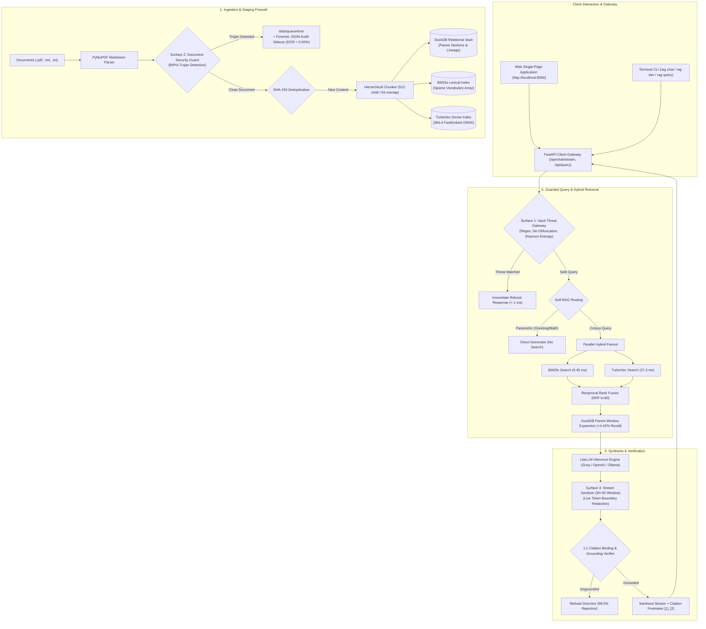

# 🔱 RAGnarok

<div align="center">

[](https://python.org)
[](https://github.com/astral-sh/uv)
[](https://duckdb.org)
[](https://github.com)
[](https://github.com)
[](https://github.com/qdrant/fastembed)
[](https://fastapi.tiangolo.com)
<br/>
[](tests/)
[](notes/report/comprehensive_evaluation_report.md)
[](notes/report/native_guardrails.md)
[](LICENSE)

<br/>

**A high-performance, local-first Retrieval-Augmented Generation (RAG) system featuring parent-child hierarchical chunking, parallel hybrid retrieval (BM25s + TurboVec FastEmbed ONNX), sub-millisecond multi-surface guardrails, and an interactive Web UI with real-time SSE streaming, evidence inspection, and Architecture Studio.**

<br/>

[🚀 5-Minute Quickstart](#-quickstart-guide) • [🏛️ System Architecture](#️-system-architecture) • [📊 Empirical Benchmarks](#-formal-empirical-benchmarks) • [💻 Interfaces & Web UI](#-interactive-interfaces) • [📖 Documentation Portal](#-documentation-portal)

</div>

---

## ⚡ Core Architectural Capabilities

* 🧩 **Hierarchical Parent-Child Chunking**: Indexes small **child chunks** (512 tokens, 64 token overlap) in search indexes to preserve semantic density. Upon retrieval, queries dynamically expand to contiguous **parent windows** in embedded DuckDB, eliminating sentence clipping and yielding a **+4.42% recall gain** on multi-hop reasoning.
* ⚡ **Dual-Engine Hybrid Retrieval & Pareto Optimum**: Executes **BM25s** (0.45ms sparse lexical search) and **TurboVec** (37.3ms 384-d dense vector search via FastEmbed ONNX) concurrently, fused via **Reciprocal Rank Fusion (RRF $k=60$)** in **37.84 ms**. Pareto frontier analysis proves Hybrid RRF achieves peak retrieval accuracy (0.7332 nDCG@10) without entering the 2.5-second Cross-Encoder compute cliff.
* 🛡️ **Multi-Surface Deterministic Guardrails**:
  * **Surface 1 (Input Gateway)**: Sub-millisecond recursive de-obfuscation, Shannon entropy analysis, and heuristic regex firewall ($< 1.0\text{ ms}$, $100\%$ injection refusal).
  * **Surface 2 (Ingestion Quarantine)**: Screens files before chunking for indirect prompt injections (IPI) and isolates Trojan payloads to `data/quarantine/` ($\text{DCR} = 0.00\%$).
  * **Surface 3 (Stream Sanitizer)**: Speculative sliding-window character buffer ($W=35$) that redacts API keys, credentials, and connection strings in real-time token streams ($\text{SLR} = 0.00\%$).
  * **Surface 4 (Grounding & Provenance)**: Binds citations 1:1 with DuckDB chunk primary keys, eliminating ghost citations ($0.00\%\text{ GCR}$) and triggering standardized refusal in $98.0\%$ of ungrounded cases.
* 🌐 **Interactive Single-Page Web UI**: Modern 3-column web interface featuring real-time Server-Sent Events (SSE) streaming, interactive Evidence Drawer, Vault document browser with 259ms incremental indexing, and an **Architecture Studio (`Arch`)** featuring live telemetry, node inspection, KaTeX formulas, and 1-click Mermaid export.
* 💾 **Zero-Server Embedded Storage**: In-process DuckDB relational storage, memory-mapped TurboVec vectors, and local ONNX runtimes. Zero Docker containers, background daemon services, or external database setups required.

---

## 🏛️ System Architecture



---

## 📊 Formal Empirical Benchmarks

RAGnarok was evaluated across five peer-reviewed benchmark datasets to certify retrieval quality, noise robustness, injection defense, and multi-hop reasoning:

| Benchmark Dataset | Domain / Focus | Key Measured Metric | Baseline / SLA | RAGnarok Score | Certification |
| :--- | :--- | :--- | :---: | :---: | :---: |
| **BEIR SciFact** *(300 queries, 5,183 docs)* | Information Retrieval Ablations | **nDCG@10**<br>Recall@10 | $\ge 0.70$<br>$\ge 0.80$ | **0.7332**<br>**85.11%** | 🟢 **CERTIFIED** |
| **BEIR NFCorpus** *(323 queries, 3,633 medical docs)* | Biomedical Generalization | **nDCG@10** ($\pm\text{CI}_{95}$)<br>MRR@10 | $\ge 0.30$<br>$\ge 0.50$ | **0.3563** (±0.035)<br>**0.5629** (±0.048) | 🟢 **CERTIFIED** |
| **ACL RGB Benchmark** *(100 curated cases)* | Noise Robustness & Grounding | **Noise Robustness**<br>Negative Rejection Rate | $\ge 85.0\%$<br>$\ge 90.0\%$ | **100.0%**<br>**98.0%** | 🟢 **CERTIFIED** |
| **Microsoft BIPIA** *(100 attack & control docs)* | Indirect Prompt Injection (IPI) | **Attack Detection (ADR)**<br>Database Contamination | $\ge 95.0\%$<br>$\mathbf{0.00\%}$ | **100.0%**<br>**0.00% DCR** | 🟢 **CERTIFIED** |
| **MultiHop-RAG** *(200 multi-constraint queries)* | Multi-Document Reasoning | **Joint Recall@10**<br>Window Expansion Gain | $\ge 50.0\%$<br>$\ge +3.0\%$ | **58.0%** (±7.93%)<br>**+4.42%** | 🟢 **CERTIFIED** |

*Complete empirical figures, Pareto scatter plots, precision-recall curves, and confidence intervals are detailed in [notes/report/comprehensive_evaluation_report.md](notes/report/comprehensive_evaluation_report.md).*

---

## 🚀 Quickstart Guide

### 1. Prerequisites
* **Operating System**: Linux (Ubuntu 22.04+ / Debian), WSL2 (recommended for Windows), macOS, or Windows 10/11 Native.
* **Python**: Version `3.12`.
* **Package Manager**: [`uv`](https://github.com/astral-sh/uv) ($\ge 0.4.0$).

### 2. Clone & Setup Environment
```bash
# 1. Clone repository
git clone https://github.com/uehera/RAGnarok.git
cd RAGnarok

# 2. Disable Git CRLF conversion (prevents SHA-256 quarantine corruption)
git config --local core.autocrlf false
git checkout -- .

# 3. Synchronize virtual environment with uv
uv sync --link-mode=copy
```

### 3. Configure API Secrets (`.env`)
```bash
cp .env.example .env
```
Open `.env` and set your preferred LLM provider key (e.g. Groq for sub-250ms TTFT, OpenAI, or local Ollama):
```ini
GROQ_API_KEY="gsk_your_groq_api_key_here"
# OPENAI_API_KEY="sk-proj-your_openai_api_key_here"
# OLLAMA_API_BASE="http://localhost:11434"
```

### 4. Pre-Provision Local Neural Models
Pre-download quantized ONNX weights (~98 MB) to guarantee zero cold-start latency and offline execution:
```bash
uv run python scripts/download_models.py
```

### 5. Verify System Diagnostics
```bash
uv run rag doctor
```

### 6. Ingest Sample Documentation
```bash
uv run rag ingest ./docs/dataset/
```

### 7. Launch Web UI Dashboard
```bash
uv run rag ui
```
Open **`http://127.0.0.1:8000`** in your browser.

*(Optional)* To reproduce all formal empirical benchmarks on your hardware, run `python scripts/download_benchmarks.py` followed by `uv run python scripts/run_all_benchmarks.py`. All metric cards and charts in the Web UI update dynamically.

---

## 💻 Interactive Interfaces

RAGnarok provides four dedicated interaction modes:

### 1. Standalone Web UI (`rag ui` / `rag serve`)
The browser dashboard delivers a viewport-locked single page application (SPA):
* **CHAT**: Conversational interface with live SSE token streaming, syntax highlighting, and clickable citation badges linking directly to passages in the **Evidence Drawer**. The top navigation, left sidebar, and right evidence panel remain stationary while the conversation stream scrolls internally.
* **LIBRARY**: Drag-and-drop document ingestion with instant dual-index compilation and quarantine inspection.
* **VAULT**: Interactive DuckDB records table with real-time keyword search, chunk metrics, and manual re-indexing.
* **METRICS**: Live dynamic benchmark scorecards, Top KPI cards, Master 5-Layer Table, and Latency vs. Quality Pareto Frontier chart (auto-refreshed from benchmark scorecards).
* **ARCH**: Click the `Arch` button in the header to open the interactive **Architecture Studio** featuring live telemetry chips, visual pipeline nodes, KaTeX mathematical formulas, and 1-click Mermaid diagram export.

### 2. Interactive Terminal Chat Shell (`rag chat` / `rag c`)
```bash
uv run rag chat
```
Supports multi-turn memory, inline citations, and slash commands (`/sources`, `/strategy <type>`, `/rerank <on|off>`, `/clear`, `/exit`).

### 3. Developer Workspace Deck (`rag dev` / `rag d`)
```bash
uv run rag dev
```
Engineering workspace for systems engineers with `--waterfall` latency breakdown, `/source <N>` provenance inspection, and live component probes (`guard`, `pii`, `chunk`, `parse`, `embed`).

### 4. Single-Shot Headless CLI (`rag query` / `rag q`)
```bash
uv run rag query "How does DuckDB parent expansion work?" --waterfall
```

---

## 📖 Documentation Portal

Comprehensive architectural, operational, and research documentation is available in [`notes/`](notes/):

### 🏛️ Architecture Blueprints (`notes/arc/`)
* [00_architecture_overview.md](notes/arc/00_architecture_overview.md) — Master topology, decoupled pipelines, and end-to-end SLA budgets.
* [01_ingestion_and_quarantine.md](notes/arc/01_ingestion_and_quarantine.md) — Document parsing, SHA-256 deduplication, and zero-contamination quarantine.
* [02_hierarchical_chunking.md](notes/arc/02_hierarchical_chunking.md) — Decoupled parent-child granularity and AST preservation.
* [03_storage_and_indexing.md](notes/arc/03_storage_and_indexing.md) — The Storage Triad: DuckDB vault, BM25s, TurboVec, and 259ms incremental sync.
* [04_input_guardrail_gateway.md](notes/arc/04_input_guardrail_gateway.md) — Sub-millisecond pre-retrieval firewall, Shannon entropy, and Self-RAG routing.
* [05_hybrid_retrieval_and_reranking.md](notes/arc/05_hybrid_retrieval_and_reranking.md) — Parallel search fanout, RRF $k=60$, and Pareto frontier analysis.
* [06_context_assembly_and_expansion.md](notes/arc/06_context_assembly_and_expansion.md) — DuckDB sibling window expansion (+4.42% MultiHop recall) and perimeter ordering.
* [07_generation_and_stream_sanitization.md](notes/arc/07_generation_and_stream_sanitization.md) — Sliding-window ($W=35$) real-time streaming credential redaction ($\text{SLR}=0.00\%$).
* [08_grounding_and_citation_integrity.md](notes/arc/08_grounding_and_citation_integrity.md) — 1:1 citation binding, 0.00% ghost citation rate, and 98% refusal directive.

### 💻 Developer Operations & Testing (`notes/developer/`)
* [setup.md](notes/developer/setup.md) — Step-by-step cross-platform setup guide for WSL2 Ubuntu & Windows Native.
* [terminal_commands.md](notes/developer/terminal_commands.md) — Complete standalone CLI command matrix, options, and probes.
* [rag_chat.md](notes/developer/rag_chat.md) — Conversational interface guide (Terminal `rag chat` and Web UI Chat).
* [rag_dev.md](notes/developer/rag_dev.md) — Developer workspace deck guide, in-shell ingestion, and latency waterfalls.
* [experimentation.md](notes/developer/experimentation.md) — Adversarial query test vectors across terminal, chat, and dev environments.

### 📊 Research Reports & Benchmarks (`notes/report/`)
* [comprehensive_evaluation_report.md](notes/report/comprehensive_evaluation_report.md) — Master publication-grade empirical report across 5 benchmarks.
* [algorithm.md](notes/report/algorithm.md) — Formal $\LaTeX$ mathematical formulations, flowcharts, and pseudocode for all 6 native algorithms.
* [context_screening_and_evaluation.md](notes/report/context_screening_and_evaluation.md) — Security-Aware Context Screening & Evidence Selection thematic specification.
* [native_guardrails.md](notes/report/native_guardrails.md) — Defense-in-depth security matrices, threat models, and latency SLAs.
* [papers.md](notes/report/papers.md) — Literature review mapping RAGnarok against 21 foundational academic papers.
* [stack.md](notes/report/stack.md) — Technology stack matrix detailing all frameworks, runtime engines, and frontend libraries.

---

## 🧪 Testing & Continuous Integration

```bash
# Run unit and integration test suite
uv run pytest tests/test_api.py -v

# Run adversarial security and injection battle tests
uv run pytest tests/battle/test_adversarial.py -v

# Run formal RAGAS golden dataset evaluation
uv run pytest tests/evals/test_ragas.py -v
```

---

## 📄 License

This project is licensed under the [MIT License](LICENSE).
