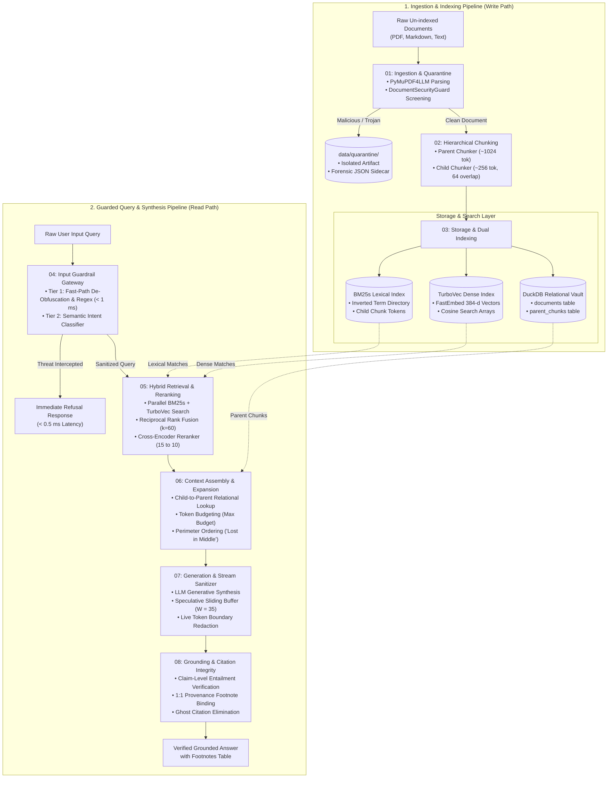

# 00 — RAGnarok Master Architecture Blueprint

> **Scope:** End-to-end data lifecycle, pipeline topology, latency budgeting, and component interaction flows.  
> **Order:** Chronological master index and navigation blueprint.

---

## 1. System Topology & Dual Pipeline Separation

RAGnarok decouples operational workflows into two independent pipelines with zero runtime resource contention:
1. **Knowledge Ingestion & Indexing Pipeline (Write Path):** An asynchronous, batch-capable pipeline that extracts layout-aware text from documents, performs pre-ingestion security screening to isolate Trojan Horse payloads, partitions text into hierarchical parent-child chunks, and updates relational and dual-index stores.
2. **Guarded Query & Synthesis Pipeline (Read Path):** A low-latency synchronous pipeline that validates user queries in sub-millisecond fast-paths, executes hybrid lexical-dense retrieval, reranks candidate passages, expands parent context from DuckDB, sanitizes streaming tokens against boundary secret leaks, and verifies factual grounding.

---

## 2. Chronological Architectural Directory

The documents in this directory represent the chronological progression of components through the system. Each document provides structural design rationales, invariants, topologies, and failure handling.

| Order | Component Document | Primary Subsystem | Key Architectural Responsibility |
| :--: | :--- | :--- | :--- |
| **01** | [`01_ingestion_and_quarantine.md`](./01_ingestion_and_quarantine.md) | Ingestion Boundary | Document parsing, Indirect Prompt Injection (IPI) screening, and zero-contamination quarantine. |
| **02** | [`02_hierarchical_chunking.md`](./02_hierarchical_chunking.md) | Data Transformation | Dual-resolution parent-child segmentation, markdown AST preservation, and provenance keys. |
| **03** | [`03_storage_and_indexing.md`](./03_storage_and_indexing.md) | Storage & Dual Indexes | Relational DuckDB parent store, BM25s inverted term index, and TurboVec dense vector store. |
| **04** | [`04_input_guardrail_gateway.md`](./04_input_guardrail_gateway.md) | Pre-Retrieval Gateway | Sub-millisecond recursive de-obfuscation, token bounding, and heuristic regex injection defense. |
| **05** | [`05_hybrid_retrieval_and_reranking.md`](./05_hybrid_retrieval_and_reranking.md) | Search & Ranking | Parallel lexical/dense retrieval, Reciprocal Rank Fusion, and Cross-Encoder distractor pruning. |
| **06** | [`06_context_assembly_and_expansion.md`](./06_context_assembly_and_expansion.md) | Context Synthesis | Relational parent resolution, token budgeting, and perimeter ordering ("Lost in the Middle"). |
| **07** | [`07_generation_and_stream_sanitization.md`](./07_generation_and_stream_sanitization.md) | Inference & Redaction | LLM generative streaming and sliding-window ($W=35$) token-boundary secret redaction. |
| **08** | [`08_grounding_and_citation_integrity.md`](./08_grounding_and_citation_integrity.md) | Verification & Grounding | Claim entailment verification, 1:1 citation binding, ghost footnote elimination, and refusal fallback. |
