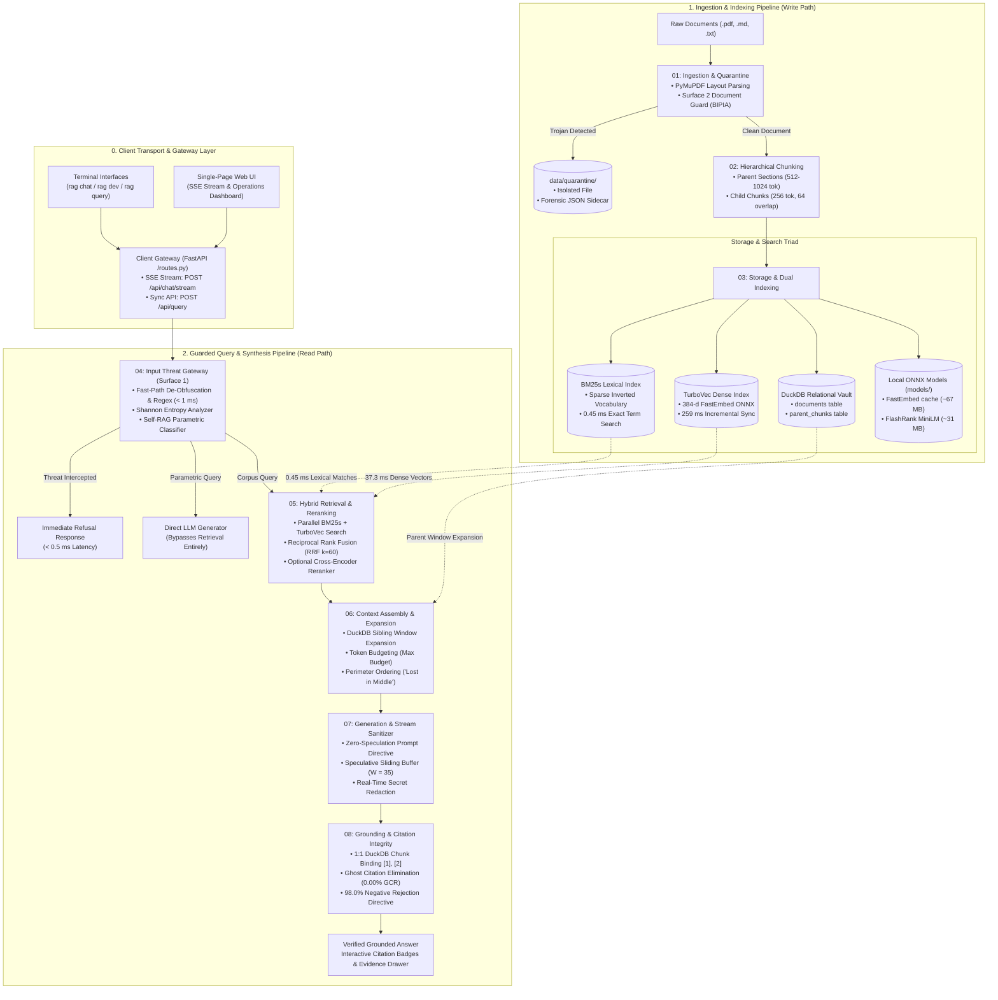

# 00 — RAGnarok Master Architecture Blueprint

> **Scope:** End-to-end data lifecycle, pipeline topology, latency budgeting, and component interaction flows.  
> **Order:** Chronological master index and navigation blueprint.

---

## 1. System Topology & Decoupled Architecture

RAGnarok decouples operational workflows into two independent pipelines with zero runtime resource contention:
1. **Knowledge Ingestion & Indexing Pipeline (Write Path):** An asynchronous pipeline that extracts layout-aware text from documents (PDF, Markdown, TXT), screens against Indirect Prompt Injection (IPI) to isolate Trojan payloads to `data/quarantine/`, partitions text into hierarchical parent-child chunks, and updates the local storage triad (DuckDB, BM25s, and TurboVec).
2. **Guarded Query & Synthesis Pipeline (Read Path):** A low-latency synchronous/streaming pipeline that validates user queries in sub-millisecond fast-paths, classifies whether retrieval is needed via Self-RAG, executes parallel hybrid lexical-dense retrieval, expands parent context windows from DuckDB, sanitizes streaming tokens in real time, and verifies citation integrity.

---

## 2. Chronological Architectural Directory

The documents in this directory represent the chronological progression of components through the system:

| Order | Component Document | Primary Subsystem | Key Architectural Responsibility |
| :--: | :--- | :--- | :--- |
| **01** | [`01_ingestion_and_quarantine.md`](./01_ingestion_and_quarantine.md) | Ingestion Boundary | Document parsing, SHA-256 deduplication, Surface 2 BIPIA Trojan screening, and quarantine isolation. |
| **02** | [`02_hierarchical_chunking.md`](./02_hierarchical_chunking.md) | Data Transformation | Dual-resolution parent-child segmentation, markdown AST preservation, and foreign key lineage binding. |
| **03** | [`03_storage_and_indexing.md`](./03_storage_and_indexing.md) | Storage Triad | Relational DuckDB vault, BM25s sparse index, TurboVec dense index, and 259ms incremental sync. |
| **04** | [`04_input_guardrail_gateway.md`](./04_input_guardrail_gateway.md) | Pre-Retrieval Gateway | Sub-millisecond de-obfuscation, Shannon entropy analysis, and Self-RAG parametric routing. |
| **05** | [`05_hybrid_retrieval_and_reranking.md`](./05_hybrid_retrieval_and_reranking.md) | Search & Ranking | Parallel lexical/dense fanout, RRF $k=60$ fusion, and Pareto frontier latency analysis. |
| **06** | [`06_context_assembly_and_expansion.md`](./06_context_assembly_and_expansion.md) | Context Synthesis | DuckDB parent window expansion (+4.42% MultiHop recall), token budgeting, and perimeter ordering. |
| **07** | [`07_generation_and_stream_sanitization.md`](./07_generation_and_stream_sanitization.md) | Inference & Redaction | LLM generative streaming and sliding-window ($W=35$) token-boundary secret redaction ($\text{SLR}=0.00\%$). |
| **08** | [`08_grounding_and_citation_integrity.md`](./08_grounding_and_citation_integrity.md) | Verification & Grounding | 1:1 citation binding, 0.00% ghost citation rate, and 98.0% negative refusal directive. |
