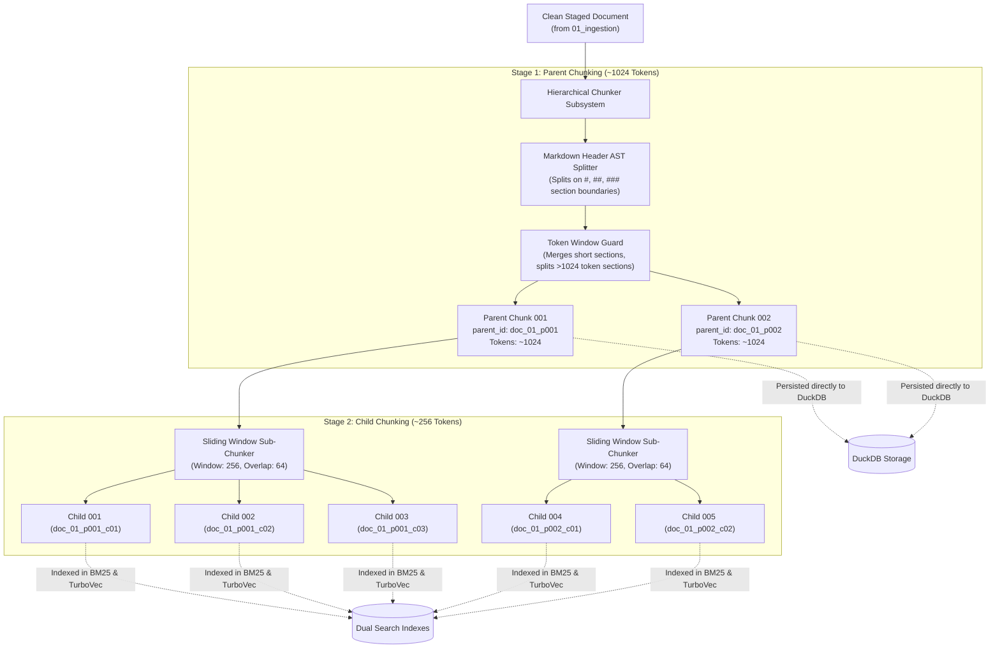

# 02 — Hierarchical Chunking Architecture

> **Lifecycle Stage:** Step 2 in Write Path (Ingestion Pipeline)  
> **Source Module:** `src/ragnarok/ingestion/chunker.py`  
> **Responsibility:** Multi-resolution document segmentation, markdown AST preservation, and parent-child provenance mapping.

---

## 1. Architectural Problem: The Granularity Dilemma

Standard RAG architectures face a fundamental tension in chunk sizing:
* **Small Chunks ($128$–$256$ tokens):** Optimize dense vector search precision and lexical BM25 matching because embeddings concentrate on specific concepts without semantic dilution. However, they lack surrounding narrative context, leading to hallucinations during generation.
* **Large Chunks ($1,000$–$2,000$ tokens):** Provide rich context for LLM generation and reasoning, but dilute embedding vectors with multiple topics, causing vector search to miss specific facts.

RAGnarok resolves this dilemma through **Hierarchical Parent-Child Chunking**:
1. Documents are segmented into **large parent chunks** (~$1,024$ tokens) representing coherent sections.
2. Each parent chunk is subdivided into **small child chunks** (~$256$ tokens with $64$-token overlap).
3. Search indexes store only the child chunks; upon retrieval, the system expands child hits back to their parent chunks in DuckDB.

---

## 2. Component Topology & Segmentation Flow

---

## 3. Technical Invariants & Segmentation Mechanics

### 3.1 Markdown AST Section Splitting
* **Structural Preservation:** The chunker utilizes markdown syntax trees to avoid arbitrary mid-paragraph splits. It prioritizes splitting on H1 (`#`), H2 (`##`), and H3 (`###`) header boundaries.
* **Context Preservation:** When a section is split into a parent chunk, the active heading hierarchy (e.g., `# Architecture > ## Storage > ### DuckDB`) is prepended to the chunk metadata to preserve semantic context.

### 3.2 Dual Windowing Parameters
* **Parent Chunks:**
  * Target size: $1,024$ tokens ($\pm 15\%$).
  * Minimum threshold: Sections under $100$ tokens are merged into adjacent paragraphs to prevent fragmented parent context.
  * Storage: Persisted in DuckDB table `parent_chunks`. Parent chunks are **never** vectorized, keeping the vector index size minimal.
* **Child Chunks:**
  * Target size: $256$ tokens.
  * Overlap: $64$ tokens ($25\%$ overlap) using a sliding token window. This ensures compound phrases or multi-line code blocks spanning chunk edges remain searchable.
  * Foreign Key Binding: Every child chunk maintains a deterministic `parent_id` foreign key linking back to its enclosing parent section.

---

## 4. Failure Modes & Edge Cases

| Edge Case | Problem Scenario | Resolution & Architectural Invariant |
| :--- | :--- | :--- |
| **Monolithic Code / Tables** | A single continuous code block or table exceeds $1,024$ tokens without markdown headers. | The parent chunker falls back to recursive line-by-line token windowing, splitting on newline boundaries (`\n`) rather than breaking mid-line. |
| **Tiny Final Section** | A document ends with a $20$-token copyright notice or brief disclaimer. | If token count $< 64$ tokens, it is appended to the preceding parent chunk rather than creating an isolated orphan parent. |
| **Token Truncation Overflow** | Non-English or Unicode-dense documents with high character-to-token ratios. | BPE tokenizer (`tiktoken`) enforces token-based counting rather than character-length approximations. |
