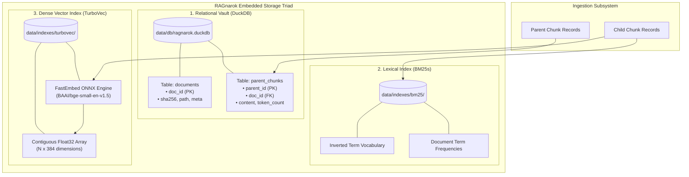

# 03 — Storage & Indexing Architecture

> **Lifecycle Stage:** Step 3 in Write Path (Ingestion Pipeline)  
> **Source Module:** `src/ragnarok/storage/`, `src/ragnarok/indexing/dense.py`, `src/ragnarok/indexing/lexical.py`  
> **Responsibility:** Relational persistence of parent documents, sparse lexical indexing, and dense vector indexing.

---

## 1. Architectural Problem: The Storage Triad

High-performance RAG pipelines require three distinct storage capabilities that rarely coexist in a single database:
1. **Relational / Structured Persistence:** Reliable storage of parent documents, metadata, and audit logs with transactional consistency and sub-10ms batch lookup by primary key.
2. **Exact Lexical Search:** Inverted index for domain jargon, error codes, identifiers, and exact phrases where semantic embeddings suffer from vocabulary dilution.
3. **Dense Vector Search:** High-throughput cosine similarity search over dense embeddings to capture conceptual meaning and natural language synonyms.

Rather than introducing heavy external dependencies (such as PostgreSQL with `pgvector` or unmanaged cloud vector stores), RAGnarok utilizes a **zero-daemon, embedded local storage triad**:

* **DuckDB:** Local relational store for documents and parent chunks.
* **BM25s:** Pure Python/NumPy sparse lexical index for child chunk terms.
* **TurboVec:** Local dense vector index powered by ONNX runtime embeddings (`BAAI/bge-small-en-v1.5`).

---

## 2. Component Topology & Storage Layout



---

## 3. Technical Invariants & Mechanics

### 3.1 DuckDB Relational Vault
* **Role:** Serves as the authoritative source of truth for full-text parent chunks and document metadata.
* **Schema Definition:**
  ```sql
  CREATE TABLE IF NOT EXISTS documents (
      doc_id VARCHAR PRIMARY KEY,
      file_path VARCHAR NOT NULL,
      file_name VARCHAR NOT NULL,
      sha256 VARCHAR NOT NULL,
      byte_size INTEGER NOT NULL,
      quarantined BOOLEAN DEFAULT FALSE,
      created_at TIMESTAMP DEFAULT CURRENT_TIMESTAMP,
      metadata JSON
  );

  CREATE TABLE IF NOT EXISTS parent_chunks (
      parent_id VARCHAR PRIMARY KEY,
      doc_id VARCHAR REFERENCES documents(doc_id),
      sequence_index INTEGER NOT NULL,
      content TEXT NOT NULL,
      token_count INTEGER NOT NULL,
      heading_path VARCHAR,
      metadata JSON
  );
  ```
* **Performance Profile:** Executes vectorized batch reads (`SELECT * FROM parent_chunks WHERE parent_id IN (...)`) in $< 15\text{ ms}$ for candidate sets.

### 3.2 BM25s Sparse Lexical Index
* **Engine:** Pure Python/NumPy lexical search library (`bm25s`).
* **Tokenization:** Splits child chunk text on whitespace and punctuation, converts to lowercase, applies language stop-word filtering, and builds an inverted term dictionary.
* **Scoring Formula:** Uses the Robertson-Spärck Jones BM25 weighting function with standard parameters ($k_1 = 1.5, b = 0.75$).
* **Persistence:** Serializes vocabulary arrays, document lengths, and posting lists into `data/indexes/bm25/`.

### 3.3 TurboVec Dense Vector Store + FastEmbed
* **Embedding Model:** `BAAI/bge-small-en-v1.5` generating 384-dimensional dense vectors.
* **Local Inference:** Runs locally via ONNX Runtime without requiring GPU dependencies or external API calls.
* **Vector Indexing:** Normalizes vectors to unit length ($\|v\|_2 = 1.0$) upon insertion. At query time, cosine similarity simplifies to a fast inner product computed over contiguous memory buffers.
* **Persistence:** Saves float32 embedding matrices and chunk ID lookup tables into `data/indexes/turbovec/`.

---

## 4. Storage Directory & Persistence Layout

```text
data/
├── db/
│   └── ragnarok.duckdb         # DuckDB relational tables
├── indexes/
│   ├── bm25/                   # BM25s inverted index files
│   │   ├── params.json
│   │   └── index.bin
│   └── turbovec/               # TurboVec vector store files
│       ├── embeddings.npy      # Normalized float32 vectors (N x 384)
│       └── metadata.json       # Child ID and document mappings
└── quarantine/                 # Quarantined malicious documents & JSON logs
```

---

## 5. Failure Modes & Edge Cases

| Failure Mode | Root Cause | System Response & Safeguard |
| :--- | :--- | :--- |
| **Index-Database Desynchronization** | Process terminated mid-indexing (e.g. SIGKILL). | `rag reindex` (`rag rx`) rebuilds both BM25s and TurboVec indexes from scratch directly from DuckDB `parent_chunks`. |
| **Concurrent Write Locks** | Simultaneous CLI write commands against DuckDB. | DuckDB client utilizes file lock timeouts and process isolation; CLI operations enforce serialized staging batches. |
| **Zero-Match Query** | Rare query tokens not present in BM25 vocabulary. | BM25s returns empty candidate set; Reciprocal Rank Fusion seamlessly falls back to dense vector results. |
