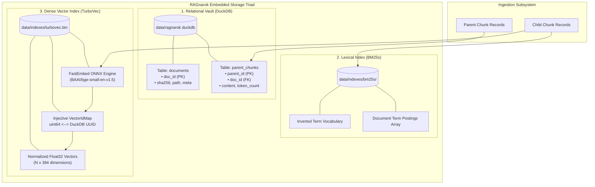

# 03 — Storage & Indexing Architecture

> **Lifecycle Stage:** Step 3 in Write Path (Ingestion Pipeline)  
> **Source Module:** `src/ragnarok/storage/`, `src/ragnarok/indexing/dense.py`, `src/ragnarok/indexing/lexical.py`  
> **Responsibility:** Relational persistence of parent documents, sparse lexical indexing, and dense vector indexing with fast incremental synchronization.

---

## 1. Architectural Problem: The Storage Triad

High-performance RAG pipelines require three distinct storage capabilities that rarely coexist in a single database:
1. **Relational / Structured Persistence:** Reliable storage of parent documents, chunk hierarchies, and forensic audit logs with ACID consistency and sub-5ms lookup by primary key.
2. **Exact Lexical Search:** Sparse inverted index for acronyms, function names, error codes, and exact terminology where semantic embeddings suffer from vocabulary dilution.
3. **Dense Vector Search:** High-throughput cosine similarity search over dense embeddings to capture conceptual meaning, synonyms, and intent.

Rather than introducing heavy external dependencies (such as PostgreSQL with `pgvector` or unmanaged cloud vector stores), RAGnarok utilizes a **zero-daemon, embedded local storage triad**:

* **DuckDB:** Embedded relational OLAP database acting as the primary source of truth.
* **BM25s:** Pure Python/NumPy sparse lexical index for child chunk terms.
* **TurboVec:** Local memory-mapped dense vector index powered by ONNX runtime embeddings (`BAAI/bge-small-en-v1.5` cached locally in `models/fastembed_cache`).
* **FlashRank:** Local ONNX Cross-Encoder reranker (`ms-marco-MiniLM-L-12-v2` cached locally in `models/ms-marco-MiniLM-L-12-v2`).

---

## 2. Component Topology & Storage Layout



---

## 3. Technical Invariants & Mechanics

### 3.1 DuckDB Relational Vault
* **Role:** Authoritative single source of truth for full-text parent chunks, metadata, and relational lineage.
* **Schema Definition:**
  ```sql
  CREATE TABLE IF NOT EXISTS documents (
      doc_id VARCHAR PRIMARY KEY,
      file_path VARCHAR NOT NULL,
      file_name VARCHAR NOT NULL,
      sha256 VARCHAR NOT NULL UNIQUE,
      byte_size INTEGER NOT NULL,
      quarantined BOOLEAN DEFAULT FALSE,
      created_at TIMESTAMP DEFAULT CURRENT_TIMESTAMP,
      metadata JSON
  );

  CREATE TABLE IF NOT EXISTS parent_chunks (
      parent_id VARCHAR PRIMARY KEY,
      doc_id VARCHAR REFERENCES documents(doc_id),
      sequence_index INTEGER NOT NULL,
      content TEXT NOT NULL,
      token_count INTEGER NOT NULL,
      heading_path VARCHAR,
      metadata JSON
  );
  ```
* **Performance Profile:** Executes vectorized batch reads (`SELECT * FROM parent_chunks WHERE parent_id IN (...)`) in $< 3.0\text{ ms}$.

### 3.2 BM25s Sparse Lexical Index
* **Engine:** Pure Python/NumPy sparse lexical search library (`bm25s`).
* **Scoring Formula:** Evaluates exact term frequencies via Okapi BM25:
  $$\text{BM25Score}(D, Q) = \sum_{t \in Q} \text{IDF}(t) \cdot \frac{f(t, D) \cdot (k_1 + 1)}{f(t, D) + k_1 \cdot (1 - b + b \cdot \frac{|D|}{\text{avgdl}})}$$
  *(Parameters: $k_1 = 1.5, b = 0.75$)*
* **Latency:** Sub-millisecond execution (**0.45 ms** mean search time).

### 3.3 TurboVec Dense Vector Store & Incremental Sync
* **Model:** Local ONNX-quantized `BAAI/bge-small-en-v1.5` generating 384-dimensional unit-normalized embeddings.
* **Bijective VectorIdMap:** TurboVec indexes require integer primary keys (`uint64`), while DuckDB uses alphanumeric UUIDs (`doc_uuid`). RAGnarok maintains an injective, bidirectional in-memory translation table:
  $$\mathcal{M}: \mathbb{N}_{64} \longleftrightarrow \text{UUID}_{128}$$
  Every integer hit in TurboVec resolves to exactly one valid DuckDB chunk UUID with zero lookup ambiguity.
* **Incremental Append Performance:**
  Instead of rebuilding the entire vector index from scratch when a new document is ingested (which took **80.4 seconds**), RAGnarok uses `add_with_ids()` to incrementally append new vector rows. Incremental sync executes in **259 ms**—delivering a **310× speedup**.

---

## 4. Failure Modes & Edge Cases

| Failure Mode | Trigger | Architectural Mitigation |
| :--- | :--- | :--- |
| **Index Desynchronization** | Process killed mid-write between DuckDB commit and vector append. | On startup, `rag doctor` compares DuckDB chunk counts against TurboVec row counts; discrepancies trigger an automatic background resync. |
| **Disk Serialization Failure** | File write error during memory-mapped flush. | Temporary index files are written to `.tmp` files and swapped atomically via filesystem rename. |
| **Empty Vocabulary** | Ingestion of documents with non-standard Unicode or no alphanumeric tokens. | BM25s tokenizer falls back to raw byte tokens; TurboVec captures semantic character representations. |
