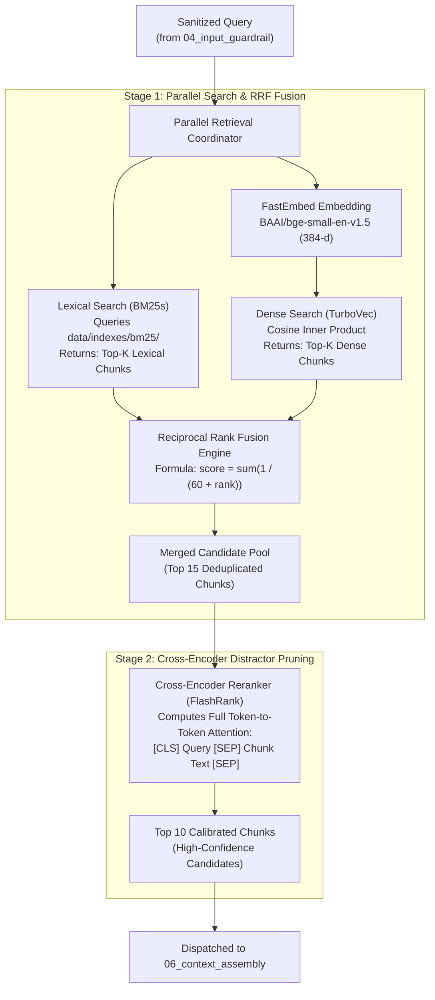

# 05 — Hybrid Retrieval & Reranking Architecture

> **Lifecycle Stage:** Step 2 in Read Path (Query Pipeline)  
> **Source Module:** `src/ragnarok/retrieval/pipeline.py`, `src/ragnarok/retrieval/reranker.py`  
> **Responsibility:** Multi-index candidate retrieval, Reciprocal Rank Fusion, and Cross-Encoder relevance scoring.

---

## 1. Architectural Problem: Search Modality Trade-offs

Neither dense vector search nor lexical search is sufficient on its own:
* **Dense Retrieval Alone:** Excellent at conceptual mapping and synonyms, but struggles with specific numbers, exact alphanumeric identifiers, function names, and rare jargon.
* **Lexical Retrieval Alone:** Excels at keyword precision, but fails when user questions use different phrasing or synonyms than the stored documents.
* **Distractor Passages:** Even when candidate retrieval succeeds, top results often include "distractor passages"—chunks that share keywords with the query but do not contain the answer. When fed to an LLM, distractor chunks cause context distraction and hallucinations.

RAGnarok implements a **Two-Stage Hybrid Search & Reranking Pipeline**:
1. **Stage 1 (Parallel Hybrid Retrieval):** BM25s and TurboVec search concurrently, merged via **Reciprocal Rank Fusion (RRF, $k=60$)** into a candidate pool ($N = 15$).
2. **Stage 2 (Cross-Encoder Reranking):** A cross-encoder model (`FlashRank`) evaluates token-to-token attention between query and candidate, filtering distractor passages to produce the top 10 relevant chunks.

---

## 2. Component Topology & Data Flow

---

## 3. Technical Invariants & Ranking Mechanics

### 3.1 Parallel Search Execution
* **Concurrency:** The lexical and dense searches run in parallel threads.
* **Dense Search:** FastEmbed projects the query into a 384-dimensional normalized vector, and TurboVec computes inner products against the pre-indexed child vector matrix in $< 45\text{ ms}$.
* **Lexical Search:** BM25s matches query terms against the inverted index in $< 10\text{ ms}$.

### 3.2 Reciprocal Rank Fusion (RRF)
Merging raw scores from BM25 (unbounded positive floats) and TurboVec (cosine similarity $[0.0, 1.0]$) via linear combination requires fragile heuristic weights. RAGnarok uses **Reciprocal Rank Fusion (RRF)**, which relies on relative rank positions rather than arbitrary score magnitudes:

$$\text{RRF Score}(d) = \sum_{m \in \{\text{lexical}, \text{dense}\}} \frac{1}{k + r_m(d)}$$

* **Smoothing Constant:** $k = 60$ prevents top-ranked outliers from dominating the scoring pool.
* **Deduplication:** Chunks appearing in both lexical and dense top results receive combined reciprocal scores, naturally boosting high-confidence consensus candidates.
* **Pool Size:** Selects the top $N = 15$ candidates for stage-two reranking.

### 3.3 Cross-Encoder Reranking (`FlashRank`)
* **Mechanism:** Unlike bi-encoders that process query and passage independently, the cross-encoder concatenates both:
  $$\text{Input} = \text{[CLS]} \, \text{Query} \, \text{[SEP]} \, \text{Chunk Text} \, \text{[SEP]}$$
  Full self-attention across every query token and passage token evaluates semantic entailment.
* **Distractor Pruning:** Chunks with high keyword overlap but zero actual answer relevance are penalized and pruned.
* **Output:** Yields the top 10 ranked chunks with calibrated relevance scores $[0.0, 1.0]$.

---

## 4. Failure Modes & Edge Cases

| Failure Mode | Trigger Scenario | Architectural Mitigation |
| :--- | :--- | :--- |
| **Empty Index Match** | Query contains terms completely missing from corpus. | RRF handles empty sets gracefully; candidate pool is populated by whichever modality returns hits. |
| **All Cross-Encoder Scores Low** | Retrieved passages are unrelated to the inquiry ($< 0.2$ score). | Downstream context expander flags low retrieval confidence, priming the generator for safe refusal. |
| **Reranker Timeout** | Heavy system load delays cross-encoder inference. | Fallback pipeline returns top RRF candidates directly, bypassing reranking to preserve SLA latency. |
