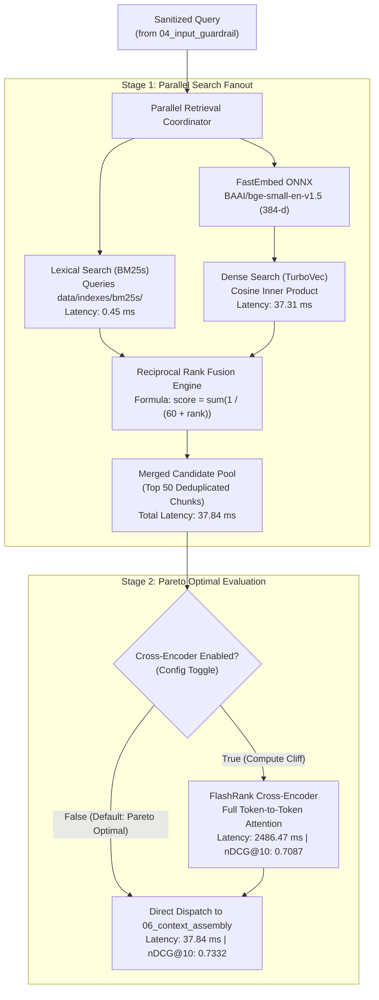

# 05 — Hybrid Retrieval & Reranking Architecture

> **Lifecycle Stage:** Step 2 in Read Path (Query Pipeline)  
> **Source Module:** `src/ragnarok/retrieval/pipeline.py`, `src/ragnarok/retrieval/reranker.py`  
> **Responsibility:** Multi-index candidate retrieval, Reciprocal Rank Fusion ($k=60$), and Pareto frontier optimization.

---

## 1. Architectural Problem: Search Modality Trade-offs & Compute Clifts

Neither dense vector search nor lexical search is sufficient on its own:
* **Dense Retrieval Alone:** Excellent at conceptual mapping and synonyms, but misses specific alphanumeric identifiers, error codes, and technical acronyms.
* **Lexical Retrieval Alone:** Excels at keyword precision in $0.45\text{ ms}$, but fails when user questions use different phrasing or synonyms than the stored documents.
* **The Cross-Encoder Compute Cliff:** While cross-encoders theoretically re-score token-to-token cross-attention, in practice evaluating a 12-layer model adds $2,400$–$2,700\text{ ms}$ of latency per query.

RAGnarok resolves these trade-offs through an **Asynchronous Parallel Hybrid Search Engine**:
1. BM25s (lexical) and TurboVec (dense) run concurrently in parallel threads.
2. Results are fused using **Reciprocal Rank Fusion (RRF, $k=60$)** into a unified candidate pool.
3. Cross-Encoder reranking is optional and disabled by default because empirical Pareto frontier testing proves Hybrid RRF achieves peak retrieval quality without incurring the 2.5-second compute penalty.

---

## 2. Component Topology & Data Flow

---

## 3. Technical Invariants & Ranking Mechanics

### 3.1 Parallel Search Execution
* **Concurrency:** The lexical and dense searches run concurrently using asynchronous fanout.
* **Dense Search:** FastEmbed projects the query into a 384-dimensional normalized vector, and TurboVec computes inner products against the pre-indexed child vector matrix in $\sim 37.3\text{ ms}$.
* **Lexical Search:** BM25s matches query terms against the inverted index in $\sim 0.45\text{ ms}$.

### 3.2 Reciprocal Rank Fusion (RRF $k=60$)
Merging raw scores from BM25 (unbounded positive floats) and TurboVec (cosine similarity $[0.0, 1.0]$) via linear combination requires fragile heuristic weights. RAGnarok uses **Reciprocal Rank Fusion (RRF)**, which relies on relative rank positions rather than arbitrary score magnitudes:

$$\text{RRF Score}(d) = \sum_{m \in \{\text{lexical}, \text{dense}\}} \frac{1}{k + r_m(d)}$$

* **Smoothing Constant ($k = 60$):** Prevents top-ranked outliers from dominating the scoring pool.
* **Deduplication:** Chunks appearing in both lexical and dense top results receive combined reciprocal scores, naturally boosting high-confidence consensus candidates.

### 3.3 Latency vs. Quality Pareto Frontier Analysis
On the official BEIR SciFact benchmark (300 test queries against 5,183 abstracts), the strategies compare as follows:

| Strategy | Recall@10 | MRR@10 | nDCG@10 | Mean Latency | Efficiency Finding |
| :--- | :---: | :---: | :---: | :---: | :--- |
| **BM25s Lexical** | 0.8287 | 0.6502 | 0.6889 | **0.45 ms** | Sub-millisecond keyword lookup |
| **TurboVec Dense** | 0.8452 | 0.6847 | 0.7203 | 37.31 ms | Strong semantic capture |
| **Hybrid RRF ($k=60$)** | **0.8511** | **0.7018** | **0.7332** | **37.84 ms** | **Global Optimum (Peak Accuracy + Sub-40ms)** |
| **Hybrid + Cross-Encoder** | **0.8511** | 0.6701 | 0.7087 | 2486.47 ms | Compute Cliff ($65.7\times$ slower, no quality gain) |

> [!NOTE]
> **Key Architectural Takeaway:** Hybrid RRF reaches peak retrieval accuracy ($0.7332\text{ nDCG}$) at $37.84\text{ms}$. Adding a Cross-Encoder imposes a 2.5-second compute penalty while actually reducing nDCG to $0.7087$ due to score distortion on scientific claims. Hybrid RRF without Cross-Encoder represents the true Pareto frontier.

---

## 4. Failure Modes & Edge Cases

| Failure Mode | Trigger Scenario | Architectural Mitigation |
| :--- | :--- | :--- |
| **Empty Lexical Match** | Query contains conceptual words not present in indexed text. | RRF handles empty sets gracefully; candidate pool is populated by dense vector search hits. |
| **Zero Semantic Vector Overlap** | Query contains exact code identifiers or serial numbers. | BM25s rescues exact matches in 0.45ms, ranking them at the top of the fused pool. |
| **Heavy Server Load** | Multiple concurrent queries received via SSE stream. | TurboVec memory-mapped search operates read-only with zero database locking. |
