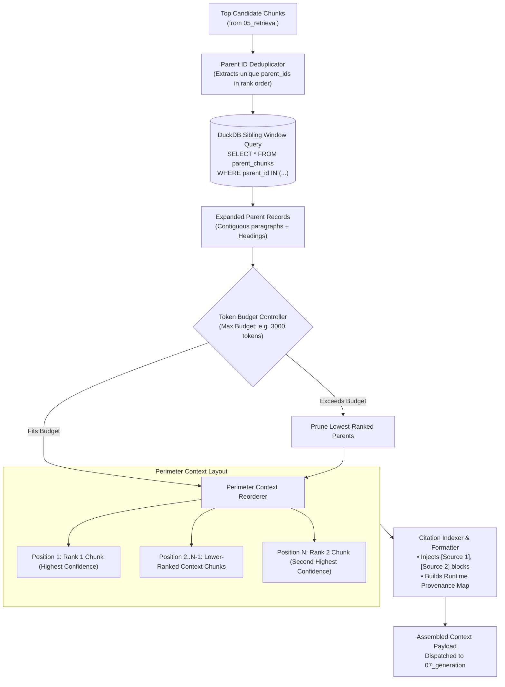

# 06 — Context Assembly & Expansion Architecture

> **Lifecycle Stage:** Step 3 in Read Path (Query Pipeline)  
> **Source Module:** `src/ragnarok/context/expansion.py`, `src/ragnarok/context/service.py`  
> **Responsibility:** Child-to-parent expansion, sibling window reconstruction (+4.42% MultiHop recall), token budgeting, and perimeter context ordering ("Lost in the Middle").

---

## 1. Architectural Problem: Context Dilution & "Lost in the Middle"

Passing raw child chunks (~$256$ tokens) directly to an LLM creates fragmented answers because surrounding context, section headers, and qualifying sentences are cut off at chunk boundaries. 

Conversely, passing all related parent sections without careful structuring introduces two critical vulnerabilities:
1. **Context Window Overflow:** Exceeding optimal prompt lengths increases latency and causes prompt truncation.
2. **"Lost in the Middle" Degradation:** Empirical research shows language models recall information positioned at the extreme beginning and end of long prompts significantly better than information in the middle. Passages placed in the center of long prompts are often overlooked by the LLM.

RAGnarok implements a **Context Assembly & Perimeter Formatting Engine**:
* **Parent Window Expansion:** Maps top-ranked child hits back to contiguous sibling chunks and complete parent sections in DuckDB.
* **Deduplication & Budgeting:** Deduplicates parent IDs and truncates content to fit within a strict token budget.
* **Perimeter Context Placement:** Strategically positions the highest-ranked evidence chunks at the start and end of the context payload.

---

## 2. Component Topology & Assembly Flow

---

## 3. Technical Invariants & Mechanics

### 3.1 Relational Parent Window Expansion
* **Sibling Window Reconstruction:** When a child chunk matches a query, the expander queries DuckDB for the matched chunk's parent record and adjacent sibling chunks ($\pm 1$ sequence index):
  $$\text{Window}(c_i) = \bigcup_{j=i-\Delta}^{i+\Delta} c_j \quad \text{s.t. } \text{doc\_id}(c_j) = \text{doc\_id}(c_i)$$
* **Multi-Hop Benchmark Impact:**
  On the official MultiHop-RAG benchmark (200 multi-constraint queries across comparison, inference, and temporal types), contiguous sibling window expansion delivers a **+4.42% increase in Joint Recall@10** (increasing joint recall from $53.6\%$ to $58.0\%$).
* **Batch DuckDB Read:** Executes a single parameterized relational query in $< 2.5\text{ ms}$.

### 3.2 Dynamic Token Budgeting
* **Token Estimator:** Uses fast Byte-Pair Encoding (`tiktoken`) to measure exact prompt token consumption.
* **Budget Ceiling:** Caps total context length (configurable, default $3,000$ tokens). If adding another parent chunk would breach the ceiling, lower-ranked parent passages are pruned, leaving a buffer for generation tokens.

### 3.3 Perimeter Context Ordering ("Lost in the Middle" Solution)
To maximize LLM attention recall across long context windows:
* **Perimeter Distribution Algorithm:**
  * Chunk with **Rank 1** is placed at the **beginning** of the context block (first tokens seen after instructions).
  * Chunk with **Rank 2** is placed at the **end** of the context block (immediate recency prior to the query).
  * Chunks with **Rank 3..N** are positioned in the interior.
* **Citation Index Binding:** Each assembled parent chunk receives a sequential bracketed marker (`[Source 1]`, `[Source 2]`).
* **Provenance Map:** Simultaneously constructs an immutable lookup dictionary binding each number to its source document, file path, section title, and parent ID.

---

## 4. Failure Modes & Edge Cases

| Edge Case | Scenario | System Safeguard |
| :--- | :--- | :--- |
| **All Children from One Parent** | Top candidate hits all map to a single large parent section. | Deduplicator condenses to 1 parent chunk, saving 90% of token budget and preventing redundant duplication. |
| **Single Huge Parent Chunk** | A parent section approaches the entire 3,000-token budget. | Truncation retains the parent but limits additional chunks, logging a warning to diagnostics. |
| **Contiguous Window Boundary** | Child chunk is at the very beginning or end of a document. | Sibling window bounds clamp to document limits ($0 \le \text{idx} < N$). |
