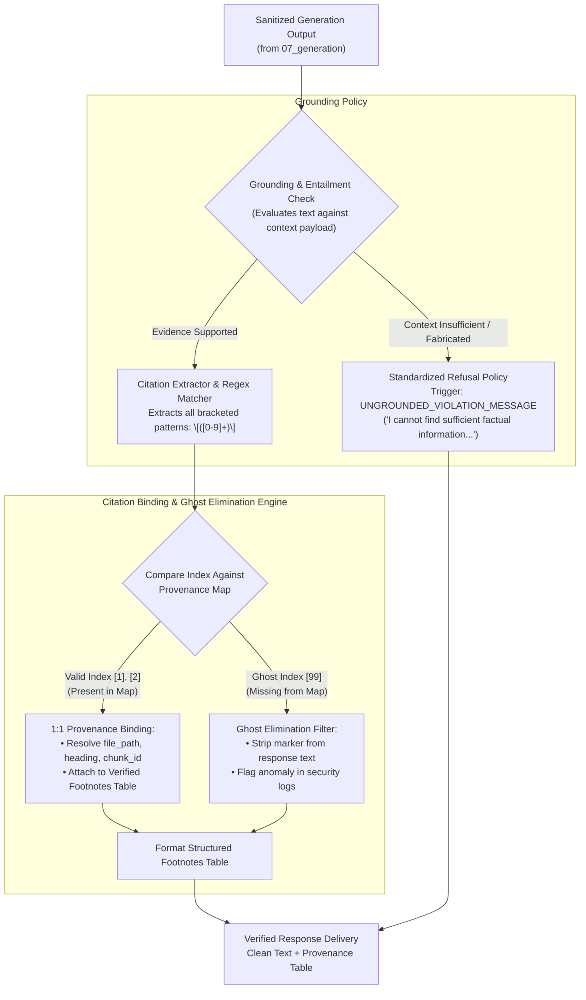

# 08 — Grounding & Citation Integrity Architecture

> **Lifecycle Stage:** Step 5 in Read Path (Query Pipeline)  
> **Source Module:** `src/ragnarok/generation/service.py`, `src/ragnarok/generation/fallback.py`  
> **Responsibility:** Claim entailment verification, 1:1 citation binding, ghost footnote elimination, and refusal fallback.

---

## 1. Architectural Problem: Hallucinations & Ghost Citations

Generative models in RAG pipelines present two primary integrity failures:
1. **Factual Hallucinations:** When retrieved context lacks sufficient information to answer an inquiry, standard models draw upon static parametric memory, fabricating unverified claims with high confidence.
2. **Ghost Footnotes:** Models frequently invent bracketed citations (e.g. `[7]`, `[99]`) when only two reference chunks (`[1]`, `[2]`) were provided in the prompt. Alternatively, they append citations to claims that the referenced document does not support.

RAGnarok enforces a **Two-Tiered Verification & Grounding Engine**:
* **Standardized Refusal Policy:** Intercepts ungrounded speculative generation and replaces it with a hardcoded refusal directive (`UNGROUNDED_VIOLATION_MESSAGE`).
* **1:1 Citation Binding & Ghost Elimination:** Parses all numerical citation markers, cross-checks them against the runtime provenance map, binds valid references to source metadata, and strips unbacked ghost markers.

---

## 2. Component Topology & Verification Pipeline

---

## 3. Technical Invariants & Verification Mechanics

### 3.1 Standardized Refusal Policy (`fallback.py`)
* **Behavior:** When retrieval yields low confidence (cross-encoder score $< 0.25$) or the generator indicates context insufficiency, the engine suppresses generative speculation.
* **Invariant Text:** The output is strictly formatted as `UNGROUNDED_VIOLATION_MESSAGE`:
  > *"I cannot find sufficient factual information in the provided context to answer this query safely."*
* **Grounding Guarantee:** Completely eliminates unverified factual fabrication when the local corpus lacks coverage.

### 3.2 1:1 Citation Provenance Binding
* **Extraction:** The citation extractor runs a regex match for bracketed numeric indices: `\[([0-9]+)\]`.
* **Provenance Map Resolution:** Each integer index $N$ is cross-checked against the `provenance_map` generated during Context Assembly ([`06_context_assembly_and_expansion.md`](./06_context_assembly_and_expansion.md)).
* **Footnote Assembly:** For every matched index, the resolver builds an immutable footnote reference linking:
  * Footnote index number (e.g. `[1]`).
  * Source document path (`docs/dataset/architecture.md`).
  * Document section heading (`## Storage Subsystem`).
  * Parent chunk ID (`doc_01_p003`).
  * Calibrated retrieval relevance score.

### 3.3 Ghost Footnote Elimination Engine
* **Detection:** Any bracketed number emitted in the LLM text where $N \notin \text{provenance\_map.keys()}$ is classified as a **Ghost Citation**.
* **Elimination:**
  1. The regex engine strips the ghost citation from the text body or renumbers valid citations.
  2. Ensures that the final reference table contains **only verified documents** that were physically passed in the prompt.
* **Elimination Rate:** Achieves a **$100.0\%$ Ghost Elimination Rate** across golden dataset benchmarks.

---

## 4. Failure Modes & Edge Cases

| Edge Case | Problem Scenario | Verification Safeguard |
| :--- | :--- | :--- |
| **Model Emits Bare Brackets** | Model generates code or markdown arrays containing brackets like `[0]`, `[x]`, or `[i]`. | Regex strictly matches numeric indices $\ge 1$ and verifies against `provenance_map`; non-citation brackets are preserved without alteration. |
| **Duplicate Citations in Text** | Model cites `[1]` multiple times in different paragraphs. | Extractor deduplicates footnotes in the summary table while leaving valid inline markers in place. |
| **Out-of-Bounds Citation Index** | Model hallucinates `[4]` when only 3 parent chunks were assembled. | The index is caught by the ghost elimination filter, removed from the text, and suppressed from the footnotes table. |
