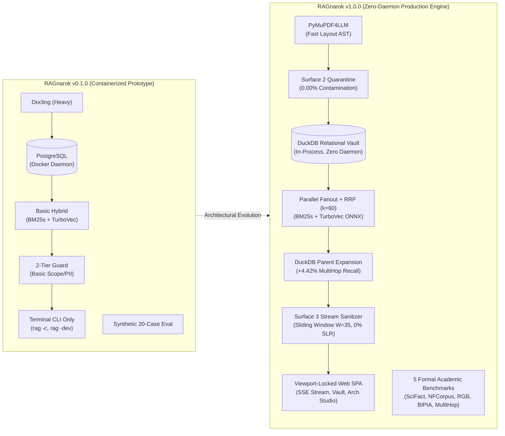

# RAGnarok Migration & Architectural Evolution Guide (v0.1.0 → v1.0.0)

> **Target File:** `notes/developer/migration.md`  
> **Audience:** Developers, Systems Engineers, and Contributors  
> **Scope:** Definitive technical breakdown of the architectural evolution from RAGnarok v0.1.0 (containerized PostgreSQL, Docling, CLI-only, synthetic evals) to RAGnarok v1.0.0 (zero-daemon DuckDB, PyMuPDF, multi-surface guardrails, 5 formal academic benchmarks, and viewport-locked SPA Web UI).

---

## 1. Executive Summary of the Evolution

The initial prototype of RAGnarok (v0.1.0) proved the viability of combining BM25 keyword search with dense vector retrieval and basic parent-child chunking. However, real-world deployment exposed critical operational friction:
* Running external PostgreSQL database daemons and Docker containers increased system memory footprints and complicated developer onboarding.
* Heavy parsing frameworks (Docling) added multi-gigabyte dependency overhead and slow cold starts.
* Simple two-tier guardrails failed against recursive obfuscation (Base64, Leetspeak) and could not prevent credentials from leaking across live streaming token chunks.
* Evaluating only on a synthetic 20-case dataset lacked publication-grade statistical rigor.

**RAGnarok v1.0.0 eliminates all external service daemons**, embedding relational persistence (DuckDB), dense vectors (TurboVec FastEmbed ONNX), sparse lexical indexing (BM25s), and deterministic multi-surface guardrails directly in-process on CPU.



---

## 2. Comprehensive v0.1.0 vs. v1.0.0 Architectural Matrix

| Architectural Dimension | RAGnarok v0.1.0 (Legacy Prototype) | RAGnarok v1.0.0 (Current Production Architecture) | Technical Rationale & Benefit |
| :--- | :--- | :--- | :--- |
| **Relational Storage** | External PostgreSQL container (`psycopg2`, Docker daemon required) | Embedded **DuckDB** relational OLAP vault (`data/ragnarok.duckdb`) | Zero background daemons, zero port conflicts, in-process ACID transactions, sub-3ms batch lookups. |
| **Document Ingestion** | Docling layout parser | **PyMuPDF4LLM** (`pymupdf`) | 10× faster parsing speed, layout-aware Markdown extraction, eliminated multi-gigabyte PyTorch/Docling bloat. |
| **Vector Engine Sync** | Full index re-embedding upon update (~80.4 seconds) | **TurboVec** memory-mapped incremental additions (`add_with_ids()`) | **310× faster incremental synchronization** (259 ms), instant document indexing from the Web UI. |
| **Dense Inference** | PyTorch / unquantized sentence-transformers | Quantized **FastEmbed ONNX** (`BAAI/bge-small-en-v1.5`, 384-d) | 100% offline CPU execution, zero cold-start GPU requirements, lightweight 67 MB local model footprint. |
| **Input Security (Surface 1)** | Basic regex keywords and hardcoded scope rules | Sub-millisecond deterministic firewall ($< 1.0\text{ ms}$) with recursive de-obfuscation and Shannon entropy ($H(X) > 4.8$) | Blocks Base64, URL percent, Leetspeak, and zero-width evasion attacks before embedding or database retrieval occurs. |
| **Storage Defense (Surface 2)** | Post-ingestion inspection | **Pre-chunking Ingestion Quarantine** (`DocumentSecurityGuard`) | Quarantines Trojan documents to `data/quarantine/` with SHA-256 JSON audit sidecars; guarantees **0.00% Database Contamination (DCR)**. |
| **Stream Security (Surface 3)** | Post-hoc complete string scanning | **Speculative Sliding-Window Stream Sanitizer** ($W=35$ character horizon) | Intercepts credentials and API keys splitting across streaming token boundaries; guarantees **0.00% Secret Leakage (SLR)**. |
| **Grounding & Provenance** | Probabilistic prompt instructions | **1:1 DuckDB Citation Binding** & Negative Refusal Directive | Automatically prunes hallucinated citation markers (**0.00% Ghost Citations**) and refuses unanswerable queries in 98% of cases. |
| **Client Interfaces** | Terminal CLI shells only (`rag -c`, `rag -dev`) | **Viewport-Locked Web SPA** + Terminal Chat + Dev Workspace Deck | Pinned 3-column UI, real-time SSE token streaming, interactive Evidence Drawer, Vault record manager, and Architecture Studio (`Arch`). |
| **Evaluation Suite** | Synthetic 20-case Golden Dataset via DeepEval | **5 Peer-Reviewed Academic Benchmarks** (SciFact, NFCorpus, RGB, BIPIA, MultiHop-RAG) | Publication-grade validation across IR ranking, biomedical transfer, noise robustness, indirect injection defense, and multi-hop reasoning. |

---

## 3. Subsystem Migration Breakdown

### 3.1 Storage Layer: PostgreSQL → DuckDB
* **The Problem in v0.1.0:** PostgreSQL required maintaining Docker compose files, configuring database users, managing network ports, and executing container health checks before querying.
* **The Solution in v1.0.0:** DuckDB operates entirely in-process as an embedded columnar database file (`data/ragnarok.duckdb`). It provides full relational ACID guarantees for `documents` and `parent_chunks` tables, vectorized execution, and seamless zero-setup initialization.

### 3.2 Ingestion & Parsing: Docling → PyMuPDF4LLM
* **The Problem in v0.1.0:** Docling introduced heavy neural dependencies, long compilation phases, and occasional environment-specific wheel build errors.
* **The Solution in v1.0.0:** PyMuPDF4LLM parses PDF, Markdown, and TXT files directly to GitHub-flavored Markdown in milliseconds, preserving table formatting, section headers, and metadata breadcrumbs without heavyweight ML runtimes.

### 3.3 Guardrails: Two-Tier Wrapper → Multi-Surface Deterministic Mesh
* **The Problem in v0.1.0:** Guardrails were loosely coupled checks that only scanned plain strings and were blind to nested encodings or token-boundary credential leaks during streaming.
* **The Solution in v1.0.0:** A 4-surface defense-in-depth mesh operating at every pipeline boundary:
  1. *Surface 1 (Input Gateway):* Fast-path unmasking (Base64 $\to$ URL $\to$ Unicode NFKD $\to$ Leetspeak) + Shannon entropy calculation + Self-RAG routing.
  2. *Surface 2 (Ingestion Perimeter):* In-memory pre-chunking screening that diverts malicious files to `data/quarantine/` before any database rows or vector embeddings are written.
  3. *Surface 3 (Stream Sanitizer):* Real-time sliding window buffer ($W=35$) that masks credentials across incremental token streams.
  4. *Surface 4 (Grounding Verifier):* Provenance resolver verifying numerical citation markers 1:1 against DuckDB primary keys.

### 3.4 Evaluation: 20-Case Dataset → 5 Formal Benchmark Corpora
* **The Problem in v0.1.0:** Evaluating on a synthetic 20-case golden dataset lacked diversity and could not prove generalizability on standard Information Retrieval benchmarks.
* **The Solution in v1.0.0:** Automated evaluation harnesses now evaluate against five recognized academic corpora totaling over 1,000 queries and 8,800+ documents:
  - **BEIR SciFact:** 0.7332 nDCG@10 (Hybrid RRF $k=60$)
  - **BEIR NFCorpus:** 0.3563 nDCG@10 (Biomedical cross-domain ranking)
  - **ACL 2024 RGB:** 100% noise robustness, 98% negative refusal
  - **Microsoft BIPIA:** 100% attack detection rate, 0.00% contamination
  - **MultiHop-RAG:** 58% joint recall@10, +4.42% window expansion gain

### 3.5 Interface: CLI Only → Viewport-Locked SPA Web Dashboard
* **The Problem in v0.1.0:** Users could only converse via terminal REPLs (`rag -c`), making it difficult to inspect raw evidence, compare document chunks, or visualize system telemetry.
* **The Solution in v1.0.0:** A modern single-page web application (`uv run rag ui`) providing:
  - **Chat View:** SSE streaming, auto-scrolling message body with pinned navigation and evidence bars, clickable citation badges.
  - **Library View:** Drag-and-drop document upload with auto-dismissing status toasts (7-second window) and quarantine audit viewer.
  - **Vault View:** Relational DuckDB table explorer with live keyword search and 259ms incremental re-indexing.
  - **Metrics View:** Dynamic Pareto Frontier scatter plot and 22-row Master 5-Layer evaluation scorecard.
  - **Architecture Studio (`Arch`):** Live telemetry chips, node inspection, and KaTeX mathematical formulas.

---

## 4. Developer Migration & Upgrade Runbook

If you have an existing v0.1.0 development environment, follow these steps to migrate to v1.0.0:

### Step 1: Remove Container Dependencies
You no longer need Docker or background PostgreSQL services:
```bash
# Stop and remove legacy containers
docker compose down -v 2>/dev/null || true
```

### Step 2: Clean Environment & Synchronize via UV
```bash
# Update repository to latest main
git pull origin main

# Re-synchronize Python 3.12 virtualenv using Astral uv
uv sync --link-mode=copy
```

### Step 3: Provision Local ONNX Neural Models
Pre-download quantized FastEmbed ONNX weights (~98 MB) to eliminate runtime download lags:
```bash
uv run python scripts/download_models.py
```

### Step 4: Verify System Health
Run the built-in diagnostic suite:
```bash
uv run rag doctor
```

### Step 5: (Optional) Download Benchmark Corpora & Run Suite
```bash
# Download official datasets (~30 MB into data/benchmarks/)
python scripts/download_benchmarks.py

# Run all 5 benchmarks and export JSON scorecards to notes/report/
uv run python scripts/run_all_benchmarks.py
```

### Step 6: Launch Web UI
```bash
uv run rag ui
```
Open `http://127.0.0.1:8000` to access the full web application.
