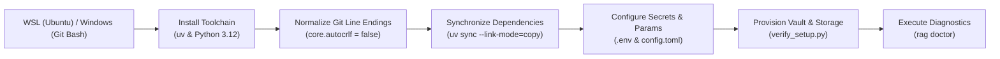

# Developer Setup & Environment Initialization (WSL & Windows Bash)

> **Target Directory:** `notes/developer/setup.md`  
> **Supported Environments:** WSL 2 (Ubuntu 22.04 / 24.04 LTS) and Windows 10/11 native via Bash (Git Bash / MSYS2).  
> **Scope:** Practical bootstrap guide, cross-platform toolchain installation, configuration examples, and environment validation.

---

## 1. Setup Architecture Overview



---

## 2. Platform Compatibility & Path Matrix

| Platform | Shell | Virtualenv Python Path | Storage Directory Style | Recommended Project Path |
| :--- | :--- | :--- | :--- | :--- |
| **WSL 2 (Ubuntu)** | `/bin/bash` | `.venv/bin/python` | Unix forward slashes (`./data`) | `~/Projects/major_project/RAGnarok` *(inside Linux ext4)* |
| **Windows Native (Git Bash)** | `mintty` / `bash.exe` | `.venv/Scripts/python.exe` | Forward slashes (`./data`) | `C:/Users/<User>/Projects/RAGnarok` |

> [!IMPORTANT]
> **WSL Performance Warning:** Never run RAGnarok from a Windows mount path like `/mnt/c/Users/...` in WSL. Accessing Windows NTFS files through WSL 9P protocol creates a **10× to 50× I/O bottleneck** on DuckDB and vector search. Always clone directly into the WSL native filesystem (`~/...`).

---

## 3. Step-by-Step Installation Walkthrough

### Step 1: Install System Toolchain & `uv`

#### Option A: WSL 2 (Ubuntu)
Open your Ubuntu WSL terminal and execute:
```bash
# 1. Update package lists and install build tools
sudo apt update && sudo apt install -y curl git build-essential

# 2. Install standalone uv binary
curl -LsSf https://astral.sh/uv/install.sh | sh

# 3. Source environment into active shell session
source "$HOME/.local/bin/env"

# 4. Confirm installation
uv --version
# Output: uv 0.4.x (or higher)
```

#### Option B: Windows via Git Bash
Open Git Bash (Run as Administrator if restricted) and execute:
```bash
# 1. Install uv directly from bash
curl -LsSf https://astral.sh/uv/install.sh | sh

# 2. Persist uv directory in Git Bash PATH
export PATH="$HOME/.local/bin:$HOME/.cargo/bin:$PATH"
echo 'export PATH="$HOME/.local/bin:$HOME/.cargo/bin:$PATH"' >> ~/.bashrc

# 3. Confirm installation
uv --version
```
*(Alternatively, execute `powershell -c "irm https://astral.sh/uv/install.ps1 | iex"` in PowerShell, then restart Git Bash).*

---

### Step 2: Normalize Git Line Endings (CRLF Prevention)
Windows Git Bash defaults to converting Linux `\n` to Windows `\r\n`. This carriage-return character corrupts SHA-256 fingerprinting in the ingestion quarantine module (`staging.py`):

```bash
# Navigate to the repository root
cd /path/to/RAGnarok

# Disable CRLF conversion for this repository
git config --local core.autocrlf false

# Reset existing working tree files to pure LF
git checkout -- .
```

---

### Step 3: Install Python 3.12 & Dependencies with UV
Execute dependency synchronization. Using `--link-mode=copy` ensures package installation succeeds across cross-filesystem mounts and Windows NTFS junctions:

```bash
uv sync --frozen --link-mode=copy
```

**Expected Terminal Output:**
```text
Resolved 68 packages in 412ms
Prepared 68 packages in 1.82s
Installed 68 packages in 2.15s
 + bm25s==0.1.10
 + duckdb==2.0.0
 + fastembed==0.9.1
 + litellm==1.40.0
 + pymupdf==2.1.0
 + turbovec==0.1.0
```

---

### Step 4: Configure Runtime Secrets & Parameters

#### 1. Configure `.env`
Create your private environment file from the provided template:
```bash
cp .env.example .env
```

Edit `.env` using your preferred terminal editor (`nano .env` or `vim .env`):
```ini
# ==============================================================================
# RAGnarok Environment Secrets
# ==============================================================================

# Primary Cloud Inference Provider (Groq provides fastest TTFT < 250ms)
GROQ_API_KEY="gsk_your_groq_api_key_here"

# Alternative Provider: OpenAI
# OPENAI_API_KEY="sk-proj-your_openai_api_key_here"

# Local Ollama Inference (optional, for fully offline environments)
# OLLAMA_API_BASE="http://localhost:11434"

# Storage & Runtime Directory Overrides (Use forward slashes for both WSL and Windows)
RAGNAROK_DATA_DIR="./data"
RAGNAROK_ENV="development"
```

#### 2. Configure `config.toml`
Inspect or adjust operational thresholds in `config.toml`:
```toml
[retrieval]
strategy = "hybrid"         # Options: "hybrid", "dense", "lexical"
candidate_pool_size = 15    # Top candidates sent to cross-encoder reranker
final_top_k = 10            # Top chunks returned after reranking
rrf_k = 60                  # Reciprocal Rank Fusion smoothing parameter

[reranker]
enabled = true              # Enable FlashRank Cross-Encoder reranking
model_name = "ms-marco-TinyBERT-L-2-v2"

[guardrails]
enabled = true
token_limit = 1024          # Instant reject threshold for context-stuffing DoS
fast_path_enabled = true    # Sub-millisecond deterministic regex & de-obfuscation
speculative_window = 35     # Character sliding buffer for streaming redaction
```

---

### Step 5: Initialize Storage Vault & Verify Directories
Run the setup verification script to create database tables and directory trees:

```bash
uv run --no-sync python scripts/verify_setup.py
```

**Expected Output:**
```text
[INFO] Verifying local directory structures...
[OK] data/db/ verified.
[OK] data/indexes/bm25/ verified.
[OK] data/indexes/turbovec/ verified.
[OK] data/quarantine/ verified.
[INFO] Checking DuckDB schema initialization...
[OK] Connected to data/db/ragnarok.duckdb.
[OK] Schema 'documents' initialized.
[OK] Schema 'parent_chunks' initialized.
[SUCCESS] Storage vault initialized successfully.
```

---

### Step 6: Diagnostic Verification (`rag doctor`)
Execute the built-in diagnostic probe to verify hardware, ONNX runtime, and database accessibility:

```bash
uv run --no-sync rag doctor
# Shorthand alias:
uv run --no-sync rag doc
```

**Expected Diagnostic Report:**
```text
╭───────────────────── RAGnarok System Diagnostics ─────────────────────╮
│ Component              Status      Details                            │
├───────────────────────────────────────────────────────────────────────┤
│ Operating System       [PASS]      Linux 6.6.x (WSL2) / Windows x86_64│
│ Python Version         [PASS]      Python 3.12.7                      │
│ Configuration          [PASS]      config.toml loaded                 │
│ DuckDB Relational      [PASS]      data/db/ragnarok.duckdb connected  │
│ Storage Directories    [PASS]      data/indexes, data/quarantine (RW) │
│ FastEmbed ONNX Engine  [PASS]      BAAI/bge-small-en-v1.5 ready       │
│ Cross-Encoder Model    [PASS]      FlashRank initialized              │
│ Input Guardrails       [PASS]      Tier 1 Fast-Path rules active      │
╰───────────────────────────────────────────────────────────────────────╯
[SUCCESS] All systems operational. Ready to ingest documents or query.
```

---

## 4. Troubleshooting & Developer FAQ

### Problem 1: `command not found: uv` after installation
* **Cause:** Shell PATH has not reloaded `$HOME/.local/bin`.
* **Fix:** In WSL execute `source "$HOME/.local/bin/env"`. In Git Bash execute `export PATH="$HOME/.local/bin:$PATH"` or restart your terminal window.

### Problem 2: `duckdb.IOException: Could not set lock on file`
* **Cause:** Another terminal session or background process has `ragnarok.duckdb` open with an active exclusive write lock.
* **Fix:** Close existing `rag dev` sessions or identify the holding process via `fuser data/db/ragnarok.duckdb` (WSL) or Task Manager (Windows).

### Problem 3: `ImportError: cannot import name ... from torch`
* **Cause:** UV attempted to create hardlinks across filesystem boundaries.
* **Fix:** Run `uv sync --frozen --link-mode=copy` to force full physical byte copies into `.venv`.
