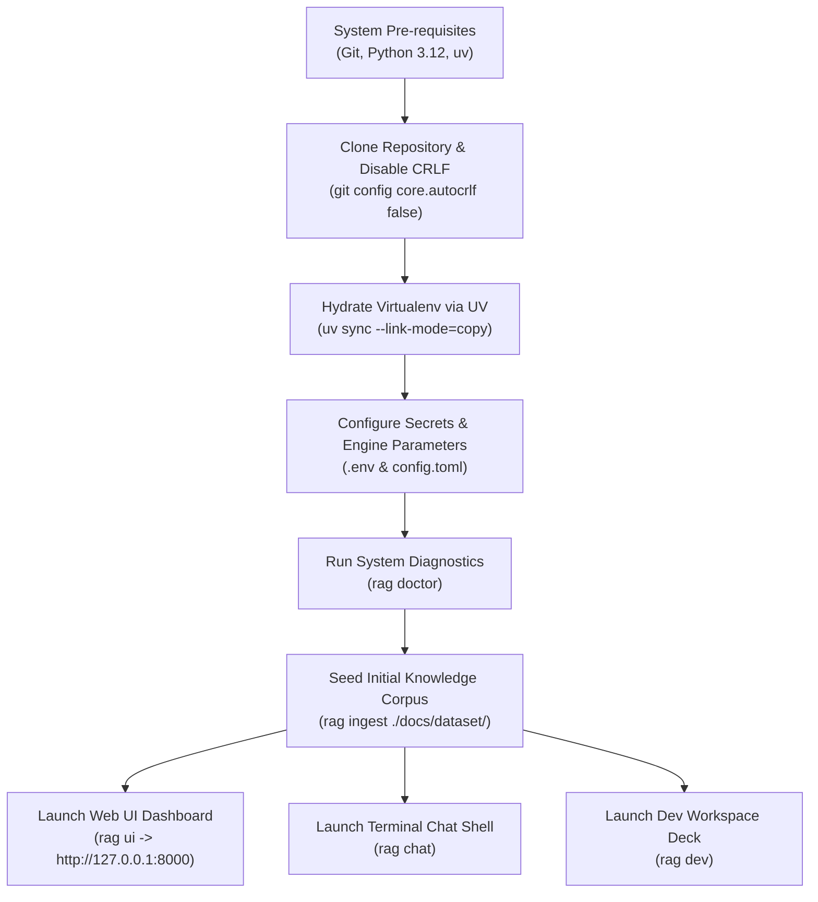

# Developer Setup & Complete Environment Initialization

> **Target File:** `notes/developer/setup.md`  
> **Supported Environments:** Linux / WSL 2 (Ubuntu 22.04 / 24.04 LTS) and Windows 10/11 Native (Git Bash / PowerShell).  
> **Scope:** Definitive step-by-step guide to installing dependencies, configuring secrets, provisioning DuckDB and search indexes, verifying system diagnostics, and launching both terminal and Web UI interfaces.

---

## 1. Setup Architecture Overview



---

## 2. Platform Compatibility & Path Matrix

| Platform | Recommended Terminal Shell | Virtualenv Python Path | Storage Directory Style | Recommended Working Directory |
| :--- | :--- | :--- | :--- | :--- |
| **WSL 2 (Ubuntu)** | `/bin/bash` or `zsh` | `.venv/bin/python` | Linux ext4 forward slashes (`./data`) | `~/Projects/major_project/RAGnarok` *(inside native Linux ext4)* |
| **Windows Native** | Git Bash (`mintty`) or PowerShell | `.venv/Scripts/python.exe` | Standard forward slashes (`./data`) | `C:/Users/<User>/Projects/RAGnarok` |

> [!IMPORTANT]
> **WSL File System Performance Rule:** Never place or run RAGnarok inside a Windows mount path such as `/mnt/c/Users/...` when using WSL 2. Cross-boundary 9P translation creates a **10× to 50× I/O performance bottleneck** on DuckDB table scans and memory-mapped index reads. Always clone and execute inside your native Linux home directory (`~/...`).

---

## 3. Step-by-Step Installation Walkthrough

### Step 1: Install System Pre-requisites & `uv` Package Manager

RAGnarok standardizes on **Astral `uv`**, an ultra-fast Rust-based package resolver that installs all virtual environments and dependencies deterministically in seconds.

#### Option A: Linux & WSL 2 (Ubuntu)
```bash
# 1. Update system packages and install build tools
sudo apt update && sudo apt install -y curl git build-essential

# 2. Install standalone uv binary
curl -LsSf https://astral.sh/uv/install.sh | sh

# 3. Source environment into active shell session
source "$HOME/.local/bin/env"

# 4. Verify installation
uv --version
# Expected: uv 0.4.x or higher
```

#### Option B: Windows Native (Git Bash or PowerShell)
In **Git Bash**:
```bash
curl -LsSf https://astral.sh/uv/install.sh | sh
export PATH="$HOME/.local/bin:$HOME/.cargo/bin:$PATH"
echo 'export PATH="$HOME/.local/bin:$HOME/.cargo/bin:$PATH"' >> ~/.bashrc
uv --version
```
In **PowerShell** (Run as Administrator):
```powershell
powershell -c "irm https://astral.sh/uv/install.ps1 | iex"
# Restart your terminal and verify:
uv --version
```

---

### Step 2: Clone Repository & Normalize Git Line Endings

Windows environments often default to converting Unix line feeds (`\n`) to Windows carriage returns (`\r\n`). In RAGnarok, carriage-return characters corrupt cryptographic SHA-256 deduplication and trigger false positives in quarantine hashing (`staging.py`).

```bash
# 1. Clone the repository
git clone https://github.com/your-username/RAGnarok.git
cd RAGnarok

# 2. Strictly disable CRLF conversion for this repository
git config --local core.autocrlf false

# 3. Reset all checked-out files to clean Unix LF line endings
git checkout -- .
```

---

### Step 3: Install Python 3.12 & Synchronize Dependencies

Using `--link-mode=copy` ensures package installation succeeds cleanly across cross-filesystem mounts, virtual drives, and NTFS junctions without hardlink permission failures:

```bash
uv sync --link-mode=copy
```

**Expected Output:**
```text
Resolved 68 packages in 420ms
Prepared 68 packages in 1.85s
Installed 68 packages in 2.10s
 + bm25s==0.1.10
 + duckdb==2.0.0
 + fastembed==0.9.1
 + fastapi==0.115.0
 + litellm==1.40.0
 + pymupdf==2.1.0
 + turbovec==0.1.0
 + uvicorn==0.30.6
```

---

### Step 4: Configure Environment Secrets (`.env`) & Parameters (`config.toml`)

#### 1. Configure `.env`
Copy the example environment configuration template:
```bash
cp .env.example .env
```

Open `.env` in your text editor and configure your preferred inference provider. RAGnarok natively supports Groq, OpenAI, Anthropic, and local Ollama:

```ini
# ==============================================================================
# RAGnarok Runtime Secrets
# ==============================================================================

# Primary Cloud Inference Provider (Groq delivers sub-250ms TTFT)
GROQ_API_KEY="gsk_your_groq_api_key_here"

# Alternative Cloud Provider: OpenAI
# OPENAI_API_KEY="sk-proj-your_openai_api_key_here"

# Alternative Local Provider: Ollama (fully offline, zero external API keys)
# OLLAMA_API_BASE="http://localhost:11434"

# Storage & Runtime Environment Overrides
RAGNAROK_DATA_DIR="./data"
RAGNAROK_ENV="development"
```

#### 2. Review Engine Settings in `config.toml`
Default operational parameters are predefined in `config.toml`:

```toml
[retrieval]
strategy = "hybrid"         # "hybrid", "dense", or "bm25"
candidate_pool_size = 50    # Top-K candidate pool retrieved before RRF fusion
final_top_k = 10            # Top chunks provided to the generator
rrf_k = 60                  # Reciprocal Rank Fusion rank dampening constant

[reranker]
enabled = false             # Cross-Encoder toggle (disabled by default for sub-40ms SLA)
model_name = "ms-marco-MiniLM-L-12-v2"

[guardrails]
enabled = true
token_limit = 1024          # Rejection threshold for context-stuffing DoS
fast_path_enabled = true    # Sub-millisecond regex & Shannon entropy checks
speculative_window = 35     # Character sliding buffer for real-time secret masking
```

---

### Step 5: Run System Diagnostics (`rag doctor`)

Verify that the local Python environment, DuckDB database permissions, FastEmbed ONNX engine, and storage directories are healthy:

```bash
uv run rag doctor
# Shorthand alias:
uv run rag doc
```

**Expected Diagnostic Report:**
```text
╭───────────────────── RAGnarok System Diagnostics ─────────────────────╮
│ Component              Status      Details                            │
├───────────────────────────────────────────────────────────────────────┤
│ Operating System       [PASS]      Linux 6.6.x (WSL2) / Windows x86_64│
│ Python Version         [PASS]      Python 3.12.x                      │
│ Configuration          [PASS]      config.toml & .env loaded          │
│ DuckDB Relational      [PASS]      data/ragnarok.duckdb accessible    │
│ Storage Directories    [PASS]      data/indexes, data/quarantine (RW) │
│ FastEmbed ONNX Engine  [PASS]      BAAI/bge-small-en-v1.5 initialized │
│ Input Guardrails       [PASS]      Deterministic Fast-Path active     │
╰───────────────────────────────────────────────────────────────────────╯
[SUCCESS] All systems operational. Ready to ingest documents or query.
```

---

### Step 6: Ingest Sample Documentation & Build Search Indexes

Before querying, seed the DuckDB relational vault and compile the BM25s inverted index and TurboVec dense embeddings:

```bash
uv run rag ingest ./docs/dataset/
# Shorthand alias:
uv run rag in ./docs/dataset/
```

**Expected Ingestion Output:**
```text
RAGnarok Ingestion Pipeline
Scanning: ./docs/dataset/
  ├── Clean Documents:       12
  └── Quarantined Threats:    0
Ingesting into DuckDB and compiling dual indexes...
[SUCCESS] Ingested 12 documents into DuckDB, TurboVec, and BM25s in 3.42s.
```

---

### Step 7: Launch Interfaces & Start Querying

RAGnarok provides multiple execution interfaces tailored for different user workflows:

#### 1. Web Application & Operations Dashboard (Recommended)
Launch the modern 3-column web interface with real-time SSE streaming, interactive Evidence Drawer, and Architecture Studio (`Arch`):
```bash
uv run rag ui
# Shorthand alias:
uv run rag serve
```
Open **`http://127.0.0.1:8000`** in your browser.

#### 2. Interactive Terminal Chat Shell
For conversing directly from the command line with multi-turn memory:
```bash
uv run rag chat
```

#### 3. Developer Workspace Deck
For systems engineering, pipeline latency profiling (`--waterfall`), and component inspection:
```bash
uv run rag dev
```

#### 4. Direct Terminal Query (Non-Interactive Headless Mode)
For scripting, CI checks, or quick lookups:
```bash
uv run rag query "How does parent-child context expansion work?"
```

---

## 4. Troubleshooting & Developer FAQ

### 1. `command not found: uv`
* **Cause:** The shell has not updated its `PATH` variable to include Astral `uv` binaries.
* **Fix:** In WSL execute `source "$HOME/.local/bin/env"`. In Git Bash execute `export PATH="$HOME/.local/bin:$PATH"` or restart your terminal.

### 2. `duckdb.IOException: Could not set lock on file`
* **Cause:** Another terminal session or background server is currently holding an exclusive write lock on `data/ragnarok.duckdb`.
* **Fix:** Terminate duplicate running processes (`kill $(pgrep -f "rag")` in WSL or end python processes in Windows Task Manager).

### 3. Slow Ingestion / Slow Vector Retrieval in WSL 2
* **Cause:** Project files are stored inside a Windows mount directory (`/mnt/c/...`) instead of native ext4 (`~/...`).
* **Fix:** Move the project directory to your Linux user home directory (`~/Projects/...`).

### 4. FastEmbed ONNX Model Download Hangs
* **Cause:** First-time initialization downloads the lightweight `bge-small-en-v1.5` ONNX model weights (~130MB) to `~/.cache/fastembed/`.
* **Fix:** Ensure network connectivity during the initial `rag doctor` or `rag ingest` command. Subsequent runs are 100% offline and load in under 50ms.
