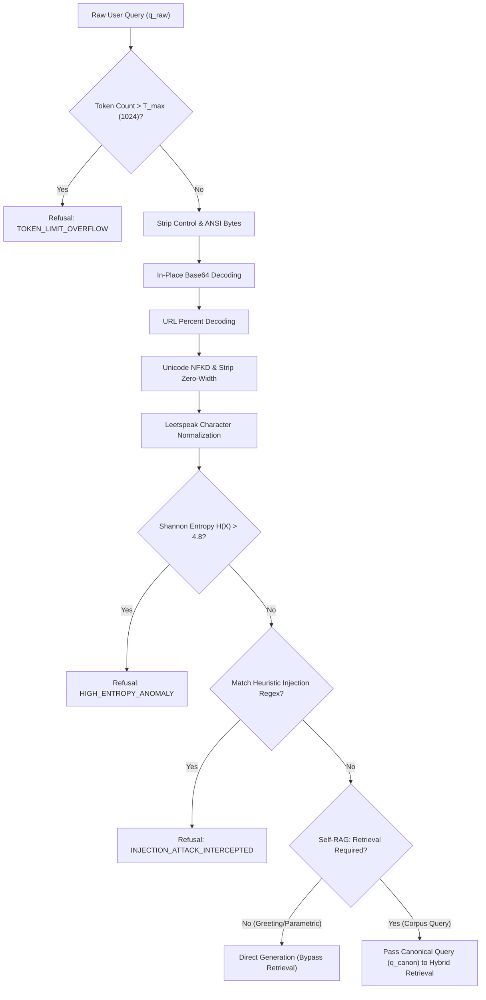
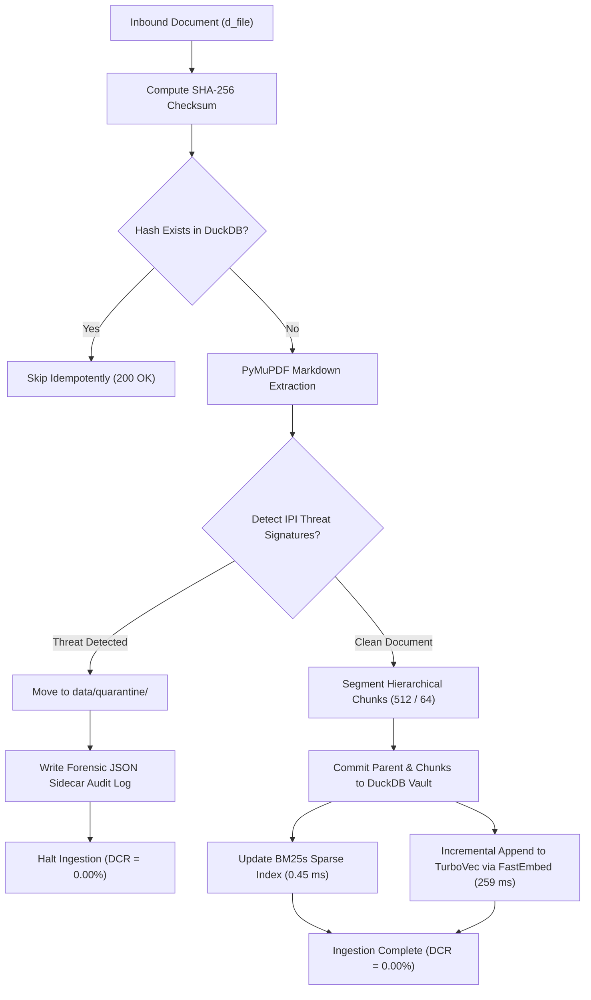
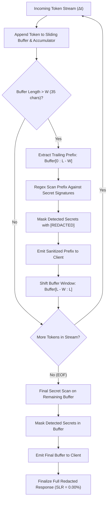
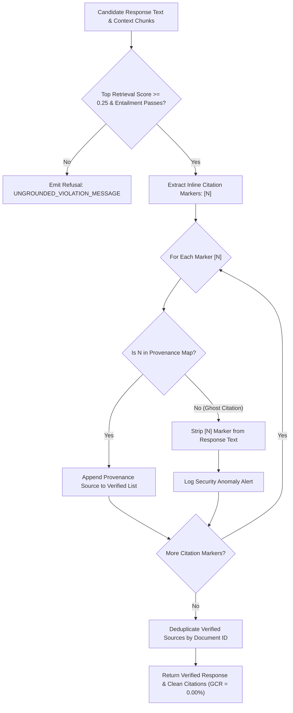

# Native Guardrail Algorithms in RAGnarok

> **Target File:** `notes/report/algorithm.md`  
> **Scope:** Clean, isolated algorithmic definitions for each native subsystem with operational explanations, Mermaid flowcharts, formal mathematical equations, and preview-compatible pseudocode for academic defense and research reporting.

---

## 1. Input Gateway Fast-Path & Self-RAG Classification

### Explanation
The Input Gateway Fast-Path Guardrail functions as an ultra-low-latency deterministic firewall ($< 1.0\text{ ms}$) intercepting adversarial queries *before* dense vector embeddings or database retrieval occur. 

Incoming queries first undergo token-length bounding to drop context-stuffing denial-of-service attempts. The query then passes through a four-stage recursive de-obfuscation pipeline: in-place Base64 extraction, URL percent decoding, Unicode normalization (NFKD) with zero-width character stripping, and leetspeak substitution. Next, Shannon entropy is calculated to detect encrypted or compressed shellcode payloads. The canonicalized query is evaluated against compiled regex injection heuristics. Queries that pass security are routed through the Self-RAG classifier, which determines whether retrieval is necessary or if the query can be resolved via parametric generation (saving 100% of retrieval compute).

### Flowchart



### Mathematical Formulation
Let the inbound raw query be $q_{\text{raw}} \in \Sigma^*$ over character alphabet $\Sigma$. The sequential canonicalization transformation $\mathcal{T}_{\text{canon}}$ is formulated as:

$$q_{\text{canon}} = \mathcal{T}_{\text{leet}} \circ \mathcal{T}_{\text{unicode}} \circ \mathcal{T}_{\text{url}} \circ \mathcal{T}_{\text{b64}}(q_{\text{clean}})$$

Character Shannon entropy $H(q_{\text{canon}})$ evaluates randomness across character frequencies $P(x_i)$:

$$H(q_{\text{canon}}) = -\sum_{i=1}^{n} P(x_i) \log_2 P(x_i)$$

The fast-path gate decision function $\mathcal{G}_{\text{input}}(q_{\text{raw}})$ is defined by:

$$\mathcal{G}_{\text{input}}(q_{\text{raw}}) = \begin{cases} 
\Omega_{\text{ref}}(\text{"TOKEN\_LIMIT"}) & \text{if } |q_{\text{raw}}|_{\text{tok}} > T_{\max} \\ 
\Omega_{\text{ref}}(\text{"ENTROPY\_ANOMALY"}) & \text{if } H(q_{\text{canon}}) > \tau_{\text{entropy}} \\ 
\Omega_{\text{ref}}(\text{"INJECTION"}) & \text{if } \exists p \in \mathcal{P}_{\text{fast}} : \text{Match}(p, q_{\text{canon}}) = 1 \\ 
\text{DIRECT\_GENERATE} & \text{if } \mathcal{C}_{\text{self\_rag}}(q_{\text{canon}}) = \text{Parametric} \\ 
q_{\text{canon}} & \text{otherwise} 
\end{cases}$$

### Algorithm

```text
Algorithm 1: Input Gateway Fast-Path & Self-RAG Classification
────────────────────────────────────────────────────────────────────────────────
Input:  Raw query string q_raw, maximum token ceiling T_max = 1024,
        entropy threshold tau_entropy = 4.8, heuristic pattern set P_fast
Output: Canonical query q_canon, DIRECT_GENERATE signal, or Refusal directive
────────────────────────────────────────────────────────────────────────────────
 1: token_count ← CountTokens(q_raw)
 2: if token_count > T_max then
 3:     return Refusal("TOKEN_LIMIT_OVERFLOW")
 4: end if
 5:
 6: q_clean ← StripControlAndANSIBytes(q_raw)
 7: q_deobf ← DecodeInPlaceBase64(q_clean)
 8: q_deobf ← URLPercentDecode(q_deobf)
 9: q_deobf ← StripZeroWidth(UnicodeNormalizeNFKD(q_deobf))
10: q_canon ← LeetspeakSubstitute(q_deobf)
11:
12: if ComputeShannonEntropy(q_canon) > tau_entropy then
13:     return Refusal("HIGH_ENTROPY_ANOMALY")
14: end if
15:
16: for each pattern p in P_fast do
17:     if RegexMatch(p, q_canon) is not empty then
18:         return Refusal("INJECTION_ATTACK_INTERCEPTED")
19:     end if
20: end for
21:
22: if IsParametricGreetingOrMath(q_canon) then
23:     return Signal("DIRECT_GENERATE")
24: end if
25:
26: return q_canon
```

---

## 2. Ingestion & Knowledge Vault Quarantine Guardrail

### Explanation
The Ingestion & Quarantine Guardrail secures the knowledge base against Indirect Prompt Injection (IPI) and poisoned document payloads. When external documents (PDFs, Markdown, Text) are submitted for ingestion, `PyMuPDF` extracts structural Markdown while preserving headers and tables. 

Before text is segmented into chunks or vectorized into TurboVec, the `DocumentSecurityGuard` performs in-memory signature screening across the full text for instruction overrides, payload delimiters, and exfiltration webhooks. If an injection directive is identified, the file is immediately diverted into `data/quarantine/<file>`, an immutable forensic JSON audit sidecar is generated with the SHA-256 fingerprint, and ingestion terminates. This guarantees exactly **0 parent rows** written to DuckDB and **0 child vectors** written to TurboVec ($\text{DCR} = 0.00\%$). Clean documents undergo cryptographic SHA-256 deduplication and 259ms incremental indexing.

### Flowchart



### Mathematical Formulation
For an inbound document $d \in \mathcal{D}_{\text{in}}$, the threat detection predicate $\Phi_{\text{IPI}}(d)$ evaluates extracted document text $T_d$:

$$\Phi_{\text{IPI}}(d) = \bigvee_{p \in \mathcal{P}_{\text{IPI}}} \mathbb{I}(\text{RegexMatch}(p, T_d) \neq \emptyset)$$

When $\Phi_{\text{IPI}}(d) = 1$, the file is quarantined with cryptographic hash $h_d = \mathcal{H}_{\text{SHA256}}(d)$. The Database Contamination Rate ($\text{DCR}$) measures isolation integrity across the relational vault $\mathcal{V}$ (DuckDB) and vector index $\mathcal{I}_{\text{dense}}$:

$$\text{DCR} = \frac{|\mathcal{Q}_{\text{quarantine}} \cap \mathcal{V}_{\text{active}}|}{|\mathcal{Q}_{\text{quarantine}}|} = 0.00\%$$

### Algorithm

```text
Algorithm 2: Ingestion Quarantine & Knowledge Isolation
────────────────────────────────────────────────────────────────────────────────
Input:  Inbound document file d_file, relational vault V (DuckDB),
        dual search indexes (I_lex, I_dense), IPI signature set P_IPI
Output: Ingestion status and DCR metric
────────────────────────────────────────────────────────────────────────────────
 1: file_hash ← ComputeSHA256(ReadRawBytes(d_file))
 2: if V.DocumentExistsByHash(file_hash) then
 3:     return { status: "DUPLICATE_SKIPPED", DCR: "0.00%" }
 4: end if
 5:
 6: doc_text ← PyMuPDF_ExtractMarkdown(d_file)
 7: detected_threats ← FindMatches(P_IPI, doc_text)
 8:
 9: if detected_threats is not empty then
10:     MoveFile(d_file, "data/quarantine/" + GetFileName(d_file))
11:     WriteJSON("data/quarantine/" + GetFileName(d_file) + ".json", {
12:         "sha256": file_hash,
13:         "threats": detected_threats,
14:         "timestamp": CurrentTimestamp()
15:     })
16:     return { status: "QUARANTINED", DCR: "0.00%" }
17: end if
18:
19: chunks ← HierarchicalChunk(doc_text, size = 512, overlap = 64)
20: V.AtomicCommit(d_file, chunks)
21: I_lex.AddTokens(chunks)
22: I_dense.IncrementalAdd(FastEmbed(chunks))
23:
24: return { status: "INDEXED", DCR: "0.00%" }
```

---

## 3. Speculative Sliding-Window Stream Sanitizer Guardrail

### Explanation
The Speculative Stream Sanitizer resolves the token-boundary credential leak in real-time streaming generation. During streaming LLM inference, credentials frequently split across consecutive token chunks (e.g., `sk-pro` + `j-abc123`), bypassing naive per-token filters. Waiting for the complete response before redacting degrades interactive latency.

The sanitizer maintains an internal sliding buffer with horizon $W = 35$ characters. Newly generated tokens append to the buffer. Once the buffer exceeds $W$ characters, only text trailing behind the active horizon ($L - W$) is scanned against compiled secret signatures (OpenAI, Anthropic, Groq, database URIs, IPv4 addresses, emails), masked in-place with `[REDACTED <TYPE>]`, and emitted to the client. Upon stream completion (EOF), the trailing buffer undergoes final evaluation and emission, guaranteeing a **$0.00\%$ Secret Leakage Rate ($\text{SLR}$)**.

### Flowchart



### Mathematical Formulation
Given an asynchronous token stream $\mathcal{S}_{\text{stream}} = (\Delta t_1, \Delta t_2, \dots)$, let the accumulated buffer at step $k$ be $\mathcal{B}_k = \sum_{j=1}^{k} \Delta t_j$. The speculative emission window prefix is governed by:

$$\text{Prefix}_k = \begin{cases} 
\mathcal{B}_k[0 : |\mathcal{B}_k| - W] & \text{if } |\mathcal{B}_k| > W \\ 
\epsilon & \text{otherwise} 
\end{cases}$$

The Secret Leakage Rate ($\text{SLR}$) verifies zero exposure of sensitive signatures $\mathcal{S}_{\text{secret}}$ across all emitted stream chunks:

$$\text{SLR} = \frac{\sum_{i=1}^{N_{\text{stream}}} \mathbb{I}(\exists s \in \mathcal{S}_{\text{secret}} : s \subseteq \text{Output}_i)}{|\mathcal{S}_{\text{secret}}|} = 0.00\%$$

### Algorithm

```text
Algorithm 3: Speculative Sliding-Window Stream Sanitizer
────────────────────────────────────────────────────────────────────────────────
Input:  Token stream S = (Δt_1, Δt_2, ...), sliding horizon W = 35 characters,
        secret signature set P_sec (API keys, DB URIs, PII)
Output: Sanitized real-time token stream with SLR = 0.00%
────────────────────────────────────────────────────────────────────────────────
 1: buffer ← ""
 2: accumulated_text ← ""
 3:
 4: for each token Δt in S do
 5:     buffer ← buffer + Δt
 6:     accumulated_text ← accumulated_text + Δt
 7:
 8:     if Length(buffer) > W then
 9:         eval_prefix ← Slice(buffer, 0, Length(buffer) - W)
10:
11:         for each pattern p in P_sec do
12:             if RegexMatch(p, eval_prefix) is not empty then
13:                 eval_prefix ← RegexReplace(p, eval_prefix, "[REDACTED]")
14:             end if
15:         end for
16:
17:         EmitToClient(eval_prefix)
18:         buffer ← Slice(buffer, Length(buffer) - W, Length(buffer))
19:     end if
20: end for
21:
22: for each pattern p in P_sec do
23:     buffer ← RegexReplace(p, buffer, "[REDACTED]")
24: end for
25: EmitToClient(buffer)
26:
27: finalized_text ← MaskAllSecrets(accumulated_text, P_sec)
28: return finalized_text
```

---

## 4. Grounding & Citation Integrity Guardrail

### Explanation
The Grounding & Citation Integrity Guardrail eliminates factual hallucinations and phantom citations post-generation. 

Before presenting answers to the user, the guardrail performs entailment verification against retrieved context chunks. If retrieval confidence is low or evidence is insufficient, the system suppresses speculative text and emits the standardized refusal directive (`UNGROUNDED_VIOLATION_MESSAGE`). 

For grounded responses, an inline citation parser identifies all bracketed numerical citations (`\[([0-9]+)\]`). Each marker is verified 1:1 against the runtime provenance map assembled during Context Assembly. If the model hallucinates an unbacked citation (e.g., `[99]`), the ghost marker is stripped from the text and logged as an anomaly, guaranteeing a **$0.00\%$ Ghost Citation Rate ($\text{GCR}$)**.

### Flowchart



### Mathematical Formulation
Let candidate response $Y$ and context chunks $\mathcal{C} = \{c_1, \dots, c_k\}$ have relevance score $s(Y, \mathcal{C})$. The factual entailment decision $\mathcal{E}(Y, \mathcal{C})$ requires:

$$\mathcal{E}(Y, \mathcal{C}) = \begin{cases} 
1 & \text{if } s(Y, \mathcal{C}) \ge \theta_{\text{conf}} \;\land\; \text{Entails}(\mathcal{C}, Y) = \text{True} \\ 
0 & \text{otherwise} 
\end{cases}$$

Given extracted citation indices $\mathcal{M}_{\text{cite}} = \{m \in \mathbb{N} \mid [m] \in Y\}$ and the domain of active provenance mapping $\text{Dom}(\text{ProvMap})$, the Ghost Citation Rate ($\text{GCR}$) satisfies:

$$\text{GCR} = \frac{|\{m \in \mathcal{M}_{\text{cite}} \mid m \notin \text{Dom}(\text{ProvMap})\}|}{|\mathcal{M}_{\text{cite}}|} = 0.00\%$$

### Algorithm

```text
Algorithm 4: Grounding & Citation Integrity Verification
────────────────────────────────────────────────────────────────────────────────
Input:  Sanitized response text Y_clean, context payload X_context with
        provenance map ProvMap, confidence threshold theta_conf = 0.25
Output: Verified response tuple (Y_verified, F_verified) or Refusal directive
────────────────────────────────────────────────────────────────────────────────
 1: retrieval_score ← X_context.TopScore
 2: if retrieval_score < theta_conf or not CheckEntailment(Y_clean, X_context) then
 3:     return Refusal("UNGROUNDED_VIOLATION_MESSAGE")
 4: end if
 5:
 6: citation_markers ← ExtractRegexMatches("\[([0-9]+)\]", Y_clean)
 7: verified_sources ← []
 8:
 9: for each marker in citation_markers do
10:     source_idx ← ParseInteger(marker)
11:     if source_idx in ProvMap then
12:         verified_sources.Append(ProvMap[source_idx])
13:     else
14:         Y_clean ← RemoveMarker(Y_clean, marker)
15:         LogSecurityAlert("GHOST_CITATION_STRIPPED", source_idx)
16:     end if
17: end for
18:
19: deduplicated_sources ← DeduplicateByDocID(verified_sources)
20: return (Y_clean, deduplicated_sources)
```
