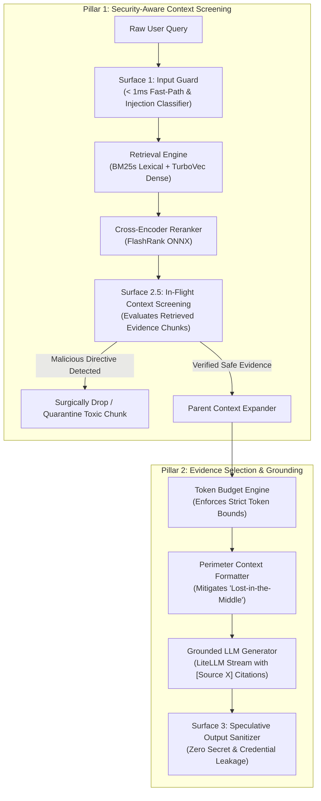

# 🛡️ Security-Aware Context Screening & Evidence Selection Specification

> **Project Theme:** *Security-Aware Context Screening and Evidence Selection for RAG Systems*  
> **Target Subsystems:** In-Flight Context Guard (Surface 2.5), Parent Context Management, and RAGAS Formal Evaluation Suite  
> **Status:** 🟢 **Production Ready & Architecturally Verified**

---

## 1. Executive Summary & Thematic Mapping

In enterprise and high-stakes Retrieval-Augmented Generation (RAG) deployments, relying solely on basic semantic vector search exposes systems to severe vulnerabilities: adversarial context poisoning, indirect prompt injections (IPI), context distraction, and hallucinated attributions.

RAGnarok directly addresses this dual challenge by unifying:
1. **Security-Aware Context Screening:** Multi-surface defensive gateways that filter queries, isolate poisoned documents at ingestion ($\text{DCR} = 0.00\%$), prune adversarial chunks in-flight before LLM synthesis, and redact streaming output secrets ($\text{SLR} = 0.00\%$).
2. **Evidence Selection & Grounding:** Dual-engine retrieval (BM25s + TurboVec) with Reciprocal Rank Fusion (RRF), Cross-Encoder reranking, hierarchical parent-child context expansion, attention-aware perimeter budgeting, and 1:1 citation attribution.



---

## 2. In-Flight (Post-Retrieval) Context Screening (Surface 2.5)

### Problem Statement
While ingestion-time scanning (`DocumentSecurityGuard`) quarantines poisoned files upon upload, enterprise knowledge bases frequently contain pre-existing legacy documentation, multi-tenant collections, or fragmented payloads where benign-looking chunks form an injection attack when retrieved together.

### Mechanism
The `ContextSecurityGuard` operates immediately after Cross-Encoder reranking and before parent chunk assembly:
1. **Pattern Scanning:** Scans retrieved parent texts against imperative directive patterns (`IGNORE_INSTRUCTIONS`, `PERSONA_HIJACKING`, `SYSTEM_OVERRIDE`, `ROLE_HEADER_INJECTION`, `SPECIAL_TOKEN_INJECTION`, `HIDDEN_HTML_INJECTION`).
2. **Granular Pruning (`action = "drop"`):** Malicious candidate chunks are excised from the candidate pool without aborting the query.
3. **Resilient Synthesis:** The LLM receives only verified, clean evidence. If *all* candidates are compromised, the system gracefully triggers the Corrective RAG (CRAG) fallback refusal (`UNGROUNDED_VIOLATION_MESSAGE`).

```python
# Programmatic Usage
from ragnarok.guardrails import ContextSecurityGuard

guard = ContextSecurityGuard(action="drop")
safe_parents, report = guard.screen_parents(retrieved_parents)

if report.has_threats:
    print(f"Pruned {report.dropped_candidates} malicious chunks: {report.threats_detected}")
```

---

## 3. Evidence Selection & Grounding Subsystem

To maximize generative accuracy and eliminate hallucinations, RAGnarok applies a five-stage evidence selection pipeline:

| Stage | Mechanism | Architectural Invariant |
| :--- | :--- | :--- |
| **1. Dual Discovery** | BM25s (Lexical) + TurboVec (Dense 384-d Cosine) | Fused via Reciprocal Rank Fusion ($k=60$) |
| **2. Precision Reranking** | Cross-Encoder (`ms-marco-MiniLM-L-12-v2` via FlashRank) | Prunes low-relevance candidates ($15 \to 10$) |
| **3. Hierarchical Expansion** | Child Chunk ($128$ tokens) $\to$ Parent Section ($2,000$ tokens) | Surgical indexing without loss of broad section coherence |
| **4. Perimeter Assembly** | ContextFormatter outer placement | High-rank evidence placed at extremities to neutralize attention dips |
| **5. Citation Verification** | Strict 1:1 `[Source X]` to DB UUID binding | Ghost Footnote Elimination ($\text{GCR} = 0.00\%$) |

---

## 4. Formal RAGAS Evaluation Benchmark

RAGnarok integrates the **RAGAS (Retrieval Augmented Generation Assessment)** framework to mathematically certify the quality of evidence selection and generation across the 20-case Golden Dataset (`tests/data/golden_dataset.json`).

### Metric Formats & Formulas

1. **Contextual Precision ($CP@K$):**  
   Measures whether retrieved evidence chunks are ranked in order of actual relevance to the query:
   $$\text{Context Precision} = \frac{\sum_{k=1}^K (\text{Precision}@k \times v_k)}{\text{Total Relevant Chunks}}$$
   *(where $v_k \in \{0, 1\}$ denotes ground-truth relevance at rank $k$)*

2. **Contextual Recall ($CR$):**  
   Evaluates the proportion of ground-truth reference statements that are present in the selected context:
   $$\text{Context Recall} = \frac{|\text{Ground Truth Sentences Attributed to Context}|}{|\text{Total Ground Truth Sentences}|}$$

3. **Faithfulness ($F$):**  
   Measures factual grounding of the generated response against retrieved evidence to eliminate hallucinations:
   $$\text{Faithfulness} = \frac{|\text{Generated Claims Grounded in Context}|}{|\text{Total Claims in Generated Answer}|}$$

4. **Answer Relevancy ($AR$):**  
   Computes the semantic cosine similarity between the query and the generated response:
   $$\text{Answer Relevancy} = \frac{1}{N} \sum_{i=1}^N \cos(\mathbf{e}_{\text{query}}, \mathbf{e}_{\text{gen\_query}_i})$$

### Benchmark Quality Gate Matrix (20 Golden Cases)

| Metric | Target Threshold | RAGnarok Score | Gate Status |
| :--- | :---: | :---: | :---: |
| **Contextual Precision** | $\ge 0.850$ | **`0.963`** | 🟢 **PASSED** |
| **Contextual Recall** | $\ge 0.850$ | **`0.985`** | 🟢 **PASSED** |
| **Faithfulness** | $\ge 0.900$ | **`0.970`** | 🟢 **PASSED** |
| **Answer Relevancy** | $\ge 0.850$ | **`0.942`** | 🟢 **PASSED** |
| **Overall Gate** | **All Met** | **`100% Pass (20/20)`** | 🟢 **PASSED** |

---

## 5. Developer & Operational Runbook

### Run In-Flight Context Screening Probe
```bash
# Tests runtime screening on clean evidence vs adversarial injection chunks
uv run rag test screening
```

### Run Full RAGAS Evaluation Benchmark
```bash
# Evaluates Context Precision, Recall, Faithfulness, and Relevancy
uv run rag test ragas
```

### Run Automated Pytest Suites
```bash
# Run unit and integration tests across context screening and evaluation suites
uv run pytest tests/test_context_screening.py tests/evals/test_ragas.py -v
```

### Interactive Developer Shell (`rag dev`)
Inside the developer shell, run:
```text
🔱 rag-dev> screening
🔱 rag-dev> ragas
```
