# 🛠️ RAGnarok — Technology Stack & Framework Inventory

> **Document Version:** 1.0.0  
> **Target Directory:** `notes/report/stack.md`  
> **Scope:** Comprehensive catalog of all programming languages, libraries, frameworks, runtime engines, and developer tools used across RAGnarok, detailing their concrete subsystem integration and architectural rationale.

---

## 1. Master Technology Stack Matrix

The table below catalogs every core tool, library, and framework employed in the architecture, implementation, verification, and deployment of RAGnarok.

| Tool / Package / Framework | Category | Version / Spec | Where Used in RAGnarok | Architectural Role & Rationale |
| :--- | :--- | :--- | :--- | :--- |
| **Python** | Runtime & Core Language | `3.12.x` | Global runtime across all modules in `src/ragnarok/` and `tests/`. | Standardized on Python 3.12 for enhanced interpreter performance, improved typing syntax (`type` statement, PEP 695), and modern async runtime stability. |
| **uv** | Package Manager & Environment | `>= 0.4.0` | Project dependency resolution, virtual environment lifecycle, and fast cross-platform execution (`uv sync`, `uv run`). | Ultra-fast Rust-based package resolver replacing pip and poetry. Ensures reproducible environments via `uv.lock` with sub-second dependency hydration. |
| **DuckDB** | Relational & Columnar Vault | `^2.0.0` | `src/ragnarok/storage/database.py`, `src/ragnarok/context/expansion.py`. | In-process, zero-daemon SQL database acting as the single source of truth for `documents` and `parent_chunks`. Executes batch parent lookups in $< 15\text{ ms}$. |
| **BM25s** | Sparse Lexical Index | `^0.1.10` | `src/ragnarok/indexing/lexical.py`, `src/ragnarok/retrieval/pipeline.py`. | Pure Python/NumPy sparse lexical search engine (`bm25s[core]`). Provides sub-10ms keyword retrieval for exact technical terms, error codes, and identifiers. |
| **TurboVec** | Local Dense Vector Engine | `^0.1.0` | `src/ragnarok/indexing/dense.py`, `src/ragnarok/retrieval/dense_search.py`. | Lightweight local-first vector store executing inner product cosine similarity searches over normalized 384-dimensional child embeddings without external daemons. |
| **FastEmbed** | Embedding Inference Engine | `^0.9.1` | `src/ragnarok/indexing/dense.py`, `src/ragnarok/cli/probes.py`. | Local ONNX-runtime dense embedding generator using `BAAI/bge-small-en-v1.5`. Produces 384-d vectors locally without PyTorch GPU bloat or external API costs. |
| **FlashRank** | Cross-Encoder Reranker | `^0.2.0` | `src/ragnarok/retrieval/reranker.py`, `src/ragnarok/cli/probes.py`. | Lightweight cross-encoder reranker evaluating full token-to-token cross-attention between queries and candidate chunks, pruning distractor passages ($15 \to 10$). |
| **PyMuPDF4LLM (`pymupdf`)** | Document Layout Parser | `^2.1.0` | `src/ragnarok/ingestion/parser.py`, `src/ragnarok/cli/probes.py`. | Extracts structured, layout-aware Markdown representations from inbound PDF documents, faithfully preserving tables, headings (`#`, `##`), and code formatting. |
| **Tiktoken** | BPE Tokenizer & Budgeting | `^0.7.0` | `src/ragnarok/ingestion/chunker.py`, `src/ragnarok/context/formatter.py`. | Fast Byte-Pair Encoding (BPE) token estimation engine used to enforce parent/child chunk bounds and dynamic prompt context ceilings ($3,000$ tokens). |
| **LangChain Text Splitters** | AST Document Chunking | `^0.2.0` | `src/ragnarok/ingestion/chunker.py`. | Provides Markdown AST structural boundary splitting, preventing arbitrary mid-sentence cuts and maintaining header breadcrumb hierarchies. |
| **LiteLLM** | Unified LLM Client Adapter | `^1.40.0` | `src/ragnarok/generation/generator.py`. | Universal inference abstraction layer providing asynchronous streaming support for cloud (Groq, OpenAI, Anthropic) and local (Ollama) model providers. |
| **FastAPI** | Web Framework & API Gateway | `^0.115.0` | `src/ragnarok/api/` (`app.py`, `routes.py`). | Asynchronous ASGI framework powering the single-page web app, static asset serving, OpenAPI Swagger docs, and Server-Sent Events (SSE) streaming (`POST /api/chat/stream`). |
| **Uvicorn** | High-Speed ASGI Web Server | `^0.30.6` | `src/ragnarok/cli/main.py` (`rag ui`, `rag serve`). | Lightning-fast async server built on `uvloop` and `httptools` providing non-blocking concurrent request handling for interactive web sessions. |
| **Chart.js** | Interactive Client Visualizations | `4.4.4` | `src/ragnarok/api/static/` (`index.html`, `app.js`). | Renders the 8 formal evaluation charts (Pareto Frontier, P-R Curve, nDCG, ADR, Latency Distribution, MultiHop reasoning) with zero npm build step. |
| **KaTeX** | Fast Math Equation Typesetting | `0.16.11` | `src/ragnarok/api/static/` (`index.html`, `app.js`). | Real-time KaTeX rendering of mathematical formulas ($H(X)$, RRF, Cosine, Precision-Recall) in the Architecture Studio (`Arch`). |
| **DOMPurify** | Client-Side HTML Sanitization | `3.1.6` | `src/ragnarok/api/static/` (`index.html`, `app.js`). | Defense-in-depth XSS protection sanitizing parsed Markdown and code before rendering in the browser DOM. |
| **Marked.js** | High-Speed GFM Markdown Parser | `13.0.2` | `src/ragnarok/api/static/` (`index.html`, `app.js`). | Fast client-side GitHub Flavored Markdown renderer for streaming chat tokens and citation badges. |
| **Typer** | CLI Framework | `^0.12.0` | `src/ragnarok/cli/main.py`, `src/ragnarok/cli/probes.py`. | Powers the RAGnarok CLI Admin Deck (`rag query`, `rag ingest`, `rag reindex`, `rag stats`, `rag doctor`, `rag test`), generating strongly-typed subcommands. |
| **Rich** | Terminal Rendering & UI | `^13.7.0` | `src/ragnarok/cli/visuals.py`, `src/ragnarok/cli/repl.py`, `src/ragnarok/cli/dev_shell.py`. | Formats tables, live waterfall latency displays, colored panels, progress bars, and streaming markdown output across CLI and REPL shells. |
| **Prompt-Toolkit** | Interactive REPL Engine | `^3.0.0` | `src/ragnarok/cli/repl.py`, `src/ragnarok/cli/dev_shell.py`. | Powers the interactive conversational shells (`rag chat` and `rag dev`) with command history, multi-line editing, and tab completion. |
| **Pydantic & Pydantic-Settings** | Data Contracts & Configuration | `^2.7.0` | `src/ragnarok/core/config.py`, `src/ragnarok/core/models.py`. | Enforces strict type validation and deserialization for `config.toml` settings, environment secrets (`.env`), and runtime data transfer objects. |
| **Structlog** | Structured Logging | `^24.1.0` | Global logging across `src/ragnarok/`. | Implements zero-allocation structured JSON and console logging with runtime log-level filtering to suppress noisy third-party provider libraries. |
| **DeepEval** | Continuous Evaluation Harness | `^1.0.0` | `tests/evals/test_golden_dataset.py`, `src/ragnarok/cli/probes.py`. | Evaluation framework powering the 21-case Golden Dataset benchmark, measuring Context Precision, Context Recall, Answer Relevancy, and Faithfulness. |
| **Pytest & Pytest-Asyncio** | Automated Testing Framework | `^8.2.0` | `tests/` directory (21 test suites, 172 tests). | Drives the entire unit, integration, battle chaos, Trojan Horse quarantine, and latency SLA verification test harness. |
| **Ruff** | Linter & Code Formatter | `^0.4.0` | Pre-commit checks and CI pipeline gating. | High-speed Rust linter enforcing strict Python 3.12 conventions, docstring checks, import sorting (`isort`), and PEP 8 compliance. |
| **Pyright** | Static Type Checker | `^1.1.360` | Static verification across `src/` and `tests/`. | Strict static type checker ensuring type safety across all function signatures, contracts, and Pydantic models. |
| **GitHub Actions** | CI/CD Automation | `.github/workflows/ci.yml` | Automated pull-request gating and verification. | Continuous integration pipeline executing test suites, security scans, and linting across Linux runners on every commit. |

---

## 2. Functional Stack Architecture

The diagram below illustrates how these frameworks and libraries integrate across the functional subsystems of RAGnarok:

```mermaid
flowchart TD
    subgraph S1["1. Ingestion & Transformation Layer"]
        P1["PyMuPDF4LLM<br>(PDF Parser)"]
        P2["LangChain Splitters<br>(Markdown AST)"]
        P3["Tiktoken<br>(BPE Windowing)"]
        P4["Python re & hashlib<br>(IPI Guard & SHA-256)"]
    end

    subgraph S2["2. Local Storage & Indexing Triad"]
        D1["DuckDB<br>(Relational Parent Store)"]
        D2["BM25s<br>(Sparse Lexical Index)"]
        D3["TurboVec + FastEmbed<br>(Dense ONNX Embeddings)"]
    end

    subgraph S3["3. Retrieval, Fusion & Ranking"]
        R1["Concurrent ThreadPool<br>(Parallel Lexical & Dense)"]
        R2["Reciprocal Rank Fusion<br>(RRF k=60 in NumPy)"]
        R3["FlashRank<br>(Cross-Encoder Reranker)"]
    end

    subgraph S4["4. Inference, Guardrails & Streaming"]
        G1["Fast-Path De-Obfuscator<br>(Base64, URL, Unicode, Leet)"]
        G2["LiteLLM<br>(Async LLM Synthesis)"]
        G3["SpeculativeStreamSanitizer<br>(Sliding Window W=35)"]
        G4["Provenance Footnote Resolver<br>(1:1 Citation Binding)"]
    end

    subgraph S5["5. CLI, Developer Deck & Verification"]
        C1["Typer + Rich<br>(CLI Admin Deck & Visuals)"]
        C2["Prompt-Toolkit<br>(Interactive REPLs)"]
        C3["Pydantic<br>(Settings & Contracts)"]
        C4["Pytest + DeepEval<br>(172 Test Suites & Golden Evals)"]
        C5["UV + Ruff + Pyright<br>(Toolchain, Linting & Types)"]
    end

    S1 --> S2
    S2 --> S3
    S3 --> S4
    S4 --> S5
```

---

## 3. Subsystem Breakdown & Integration Details

### 3.1 Document Ingestion & Quarantine Engine
* **PyMuPDF4LLM (`pymupdf`):** In `parser.py`, converts binary PDF streams into GitHub-flavored Markdown tables and text headings, maintaining structural context that flat text extractors lose.
* **Hashlib & Regex:** In `staging.py`, generates SHA-256 fingerprints and scans for Indirect Prompt Injections (IPI) before chunking, routing malicious files to `data/quarantine/`.
* **Tiktoken & LangChain Text Splitters:** In `chunker.py`, splits clean Markdown into $1,024$-token parent blocks and $256$-token child chunks with $64$-token overlaps.

### 3.2 Dual Search & Storage Triad
* **DuckDB:** In `storage/database.py`, maintains persistent tables `documents` and `parent_chunks` in `data/db/ragnarok.duckdb`. Restores complete parent text from child pointers in $< 15\text{ ms}$.
* **BM25s:** In `indexing/lexical.py`, indexes child chunk tokens into memory-mapped inverted indices in `data/indexes/bm25/`.
* **TurboVec & FastEmbed:** In `indexing/dense.py`, runs ONNX-quantized `BAAI/bge-small-en-v1.5` embeddings, storing float32 vector arrays in `data/indexes/turbovec/`.

### 3.3 Retrieval & Context Assembly
* **NumPy:** In `retrieval/reranker.py`, executes Reciprocal Rank Fusion ($k=60$) score calculation over candidate rank positions.
* **FlashRank:** In `retrieval/reranker.py`, computes token-to-token cross-attention over the top-15 candidate pool to prune distractor passages down to the top-10.
* **Context Formatter:** In `context/formatter.py`, performs perimeter ordering (placing Rank 1 at the start and Rank 2 at the end) to eliminate the "Lost in the Middle" attention degradation.

### 3.4 Inference & Multi-Surface Guardrails
* **Fast-Path Engine:** In `guardrails/fast_path.py`, performs recursive multi-encoding unmasking (Base64, URL percent-encoding, Unicode NFKD, and leetspeak substitutions) in $< 0.5\text{ ms}$.
* **LiteLLM:** In `generation/generator.py`, dispatches asynchronous streaming requests across configured LLM providers with automatic retry handling.
* **SpeculativeStreamSanitizer:** In `generation/sanitizer.py`, runs an internal 35-character sliding window buffer over live tokens to intercept split credentials (API keys, DB URIs, PII) before terminal flush.

### 3.5 Developer Experience, CLI & Evaluation
* **Typer & Rich:** In `cli/main.py`, `cli/probes.py`, and `cli/visuals.py`, provides the operational command suite with interactive progress bars, tables, and per-stage latency waterfalls (`--waterfall`).
* **Prompt-Toolkit:** In `cli/repl.py` and `cli/dev_shell.py`, manages interactive session turn history, slash commands (`/sources`, `/strategy`, `/rerank`), and in-shell diagnostics.
* **DeepEval & Pytest:** In `tests/evals/test_golden_dataset.py`, automatically scores offline runs against the Evaluation Triad (Context Precision $\ge 0.86$, Context Recall $\ge 0.85$, Faithfulness $\ge 0.90$, Answer Relevancy $\ge 0.85$).
